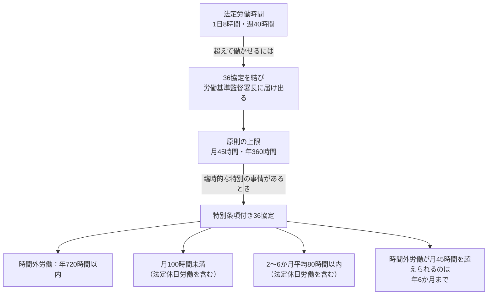

<!-- TARGET_KW: 36協定とは -->
<!-- READER: S3-知的好奇心-学習中 / 検索｜労基法36条と残業の関係を知りたい社会人 -->
<!-- ANSWER: 法定時間外・法定休日の労働に必要な協定の締結と届出を、所定外残業や賃金とは分ける。 -->
<!-- TAKEAWAY: 36協定の要否、特別条項の上限、割増賃金との区別 -->

残業と36協定の関係は、会社で決めた勤務時間と、法律上の労働時間を分けると整理できます。まず「36協定とは」の定義を確認し、必要になる条件と上限の読み方を押さえます。

## 36協定とは

「36協定」とは、時間外・休日労働に関する労使協定で、労働基準法<strong>第36条</strong>に基づいて定められることから、この通称で呼ばれています。[出典：厚生労働省「労働時間・休日」](https://www.mhlw.go.jp/stf/seisakunitsuite/bunya/koyou_roudou/roudoukijun/roudouzikan/index.html)

会社が労働者に<strong>法定労働時間（原則1日8時間、1週40時間）</strong>を超えて残業させたり、<strong>法定休日（原則として毎週少なくとも1日、または4週間で4日以上）</strong>に労働させたりする場合、労働者の過半数で組織する労働組合、または労働者の過半数を代表する者と書面で締結し、労働基準監督署長に届け出る必要があります。この届出をせずに法定時間外・法定休日の労働をさせると、労働基準法違反となり罰則の対象になります。

協定には、時間外労働をさせられる業務の種類・労働者の範囲・上限時間（一般則では原則<strong>月45時間、年360時間</strong>）を具体的に定める必要があります。

法定労働時間から特別条項までの関係を図にすると、次のようになります。



出典: [労働基準法（e-Gov法令検索）](https://laws.e-gov.go.jp/law/322AC0000000049) 第32条・第36条、[労働時間・休日｜厚生労働省](https://www.mhlw.go.jp/stf/seisakunitsuite/bunya/koyou_roudou/roudoukijun/roudouzikan/index.html)

以下は2026年10月31日時点の一般則です。変形労働時間制の一部や、業務・制度による特例は別に確認します。

年720時間と月45時間超の回数は時間外労働、単月100時間未満と2〜6か月平均80時間以内は法定休日労働も含む点に注意してください。[出典：厚生労働省「労働基準法」](https://www.check-roudou.mhlw.go.jp/law/roudoukijun.html)

### 所定外残業と法定時間外労働を分ける

次は、通常の労働時間制で日8時間・週40時間が適用される場合の学習例です。実際には勤務制度と週合計も確認します。

| 条件 | 36協定についての判断 | 理由 |
| --- | --- | --- |
| 所定7時間の日に8時間働き、週40時間以内 | その延長だけでは法定時間外にならない | 所定外と法定時間外は違う |
| 1日8時間を超えて働かせる | 原則として事前の締結と届出が必要 | 法定時間外労働に当たる |
| 法定休日に働かせる | 原則として事前の締結と届出が必要 | 時間外労働とは別に休日労働の確認が必要 |
| 割増賃金を支払っているが36協定がない | 支払だけで法定時間外労働が適法になるわけではない | 手続と賃金は別の要件 |

[出典：厚生労働省「労働時間・休日」](https://www.mhlw.go.jp/stf/seisakunitsuite/bunya/koyou_roudou/roudoukijun/roudouzikan/index.html)

## 3行まとめ
*   <strong>労働基準法</strong>: 賃金や労働時間、休日、解雇など、労働者が安心して働けるよう、企業が守るべき労働条件の「最低基準」を定めた法律です。この法律があることで、企業は最低基準を下回る労働条件を定めることができず、労働者の権利が保護されます。IT業界ではプロジェクトの特性上、労働時間が変動しやすいため、この最低基準を知っておくことは自身の働き方を守る上で非常に重要ですし、ITパスポートの法務の学習にもつながります。[出典：厚生労働省「労働基準法」](https://www.check-roudou.mhlw.go.jp/law/roudoukijun.html)
*   <strong>36協定</strong>: 会社が労働者に法定労働時間（原則1日8時間、1週40時間）を超えて残業させたり、法定休日（原則として毎週少なくとも1日、または4週間で4日以上）に労働させたりする際に、労働者の過半数で組織する労働組合、または労働者の過半数を代表する者と書面で締結し、労働基準監督署長に届け出る必要がある協定です。届出には時間外・休日労働に関する協定届を用い、労働基準法第36条に基づいて定められることから「36協定（サブロク協定）」と呼ばれています。
*   <strong>IT現場の視点</strong>: ITプロジェクトは納期が厳しく、予期せぬトラブルで残業が発生しやすい特性があります。そのため、労働基準法や36協定は、裁量労働制や高度プロフェッショナル制度といった、IT現場で適用されうる特別な労働時間制度を理解する上での基礎となります。これらの制度が適用される場合でも、労働基準法の基本的な考え方が根底にあるため、その知識は不可欠であり、実務で自身の権利を守るためにも重要です。

## 試験での出題ポイント
労働基準法を学ぶ際は、労働時間・36協定・休憩・休日・割増賃金を分けて確認します。ここでは出題頻度の順位づけではなく、制度の違いを整理します。

1.  <strong>法定労働時間</strong>: 労働基準法が定める原則的な労働時間の基準です。原則として「1日8時間、1週40時間」以内と定められています。これを超える労働は「時間外労働」と呼ばれ、原則として36協定の締結と届出がなければ違法となります。ITプロジェクトでは、設計、開発、テスト、運用とフェーズによって忙しさが異なるため、この基準を理解し、自身の労働時間が適正かを確認することは、過重労働から身を守るために重要です。
2.  <strong>36協定（労働基準法第36条）</strong>: 会社が法定労働時間を超えて働かせる（残業させる）場合や、法定休日に労働させる場合に、あらかじめ労使間で書面による協定を結び、所轄の労働基準監督署長に届け出なければならない協定です。この協定には、時間外労働をさせることができる業務の種類、労働者の範囲、そして最も重要な時間外労働の上限時間（原則として月45時間、年360時間）を具体的に定める必要があります。もし36協定がない状態で残業をさせたり、協定の上限を超えて労働させたりすると、企業は労働基準法違反となり、罰則の対象となります。[出典：厚生労働省「労働時間・休日」](https://www.mhlw.go.jp/stf/seisakunitsuite/bunya/koyou_roudou/roudoukijun/roudouzikan/index.html)
    *   <strong>特別条項付き36協定</strong>: 通常の上限時間を超えて時間外労働をさせる必要がある「特別な事情」がある場合に限り、労使の合意があれば、さらに長い時間外労働を可能にする特別条項を設けることができます。しかし、この場合でも、年720時間以内、月100時間未満（法定休日労働を含む）、2〜6か月の平均80時間以内（法定休日労働を含む）、月45時間を超えられるのは年6か月まで、という上限が設けられており、際限なく残業をさせられるわけではありません。これは、過労死防止の観点から設けられた重要な規制であり、IT現場で突発的なトラブル対応などで残業が増える際にも確認すべきルールです。[出典：厚生労働省「労働基準法」](https://www.check-roudou.mhlw.go.jp/law/roudoukijun.html)
3.  <strong>休憩時間</strong>: 労働時間が6時間を超える場合は最低45分、8時間を超える場合は最低1時間の休憩を労働時間の途中に与える必要があります。この休憩時間は原則として「一斉に」与えることが求められていますが、運輸交通業や商業など、一部の業種では例外が認められています。IT企業では、プロジェクトの進行状況によっては休憩が取りにくい状況も発生しがちですが、休憩は労働者の心身のリフレッシュと安全確保のために不可欠であり、企業は適切に与える義務があります。[出典：厚生労働省「労働時間・休日」](https://www.mhlw.go.jp/stf/seisakunitsuite/bunya/koyou_roudou/roudoukijun/roudouzikan/index.html)
4.  <strong>休日労働</strong>: 労働基準法では、使用者は労働者に対して「毎週少なくとも1回の休日」または「4週間を通じて4日以上の休日」を与えなければならないと定めています。これを「法定休日」と呼びます。法定休日に労働させる場合も、36協定の締結と届出が必要です。法定休日に労働させた場合は、通常の賃金に加えて割増賃金（35%以上）を支払う義務があります。ITプロジェクトでは、リリース作業や緊急対応で休日出勤が発生することもありますが、その日が法定休日かどうかを先に確認します。[出典：労働基準法第35・37条](https://laws.e-gov.go.jp/law/322AC0000000049)
5.  <strong>割増賃金</strong>: 法定労働時間を超えて労働させた場合（時間外労働）、深夜（午後10時から午前5時まで）に労働させた場合、法定休日に労働させた場合には、通常の賃金に一定の割合を上乗せした「割増賃金」を支払う義務があります。法定時間外・深夜・法定休日という区分で確認します。
    *   時間外労働：25%以上（月60時間を超える場合は50%以上）
    *   深夜労働：25%以上
    *   法定休日労働：35%以上
    これらの割増賃金は重複して支払われる場合もあります（例：深夜の時間外労働）。IT現場では、深夜に及ぶシステムメンテナンスやリリース作業が発生することもあるため、これらのルールは自身の給与明細を確認する上でも重要な知識です。[出典：労働基準法第37条](https://laws.e-gov.go.jp/law/322AC0000000049)

## 【AIハック】生成AIで複雑な契約を噛み砕く

生成AIは、所定外と法定時間外を区別する対話相手に使えます。個別の労務判断は勤務制度や協定の内容で変わるため、AIの回答だけで適法性を決めず、公式資料や相談窓口で確認してください。

### プロンプト例:

```text
労働基準法と36協定を学んでいます。
通常の労働時間制で、法定労働時間は日8時間・週40時間とします。
所定7時間の日に8時間働き、週40時間以内だった例と、
1日9時間働いた例では、36協定の検討がどう違いますか。
まず私に所定外と法定時間外の違いを説明させ、
不足する前提を問い返してください。
法定休日と割増賃金も別に考えます。個別の法的結論は断定しないでください。
```

<!-- AI_EXAMPLE: 使うAI=ChatGPT / プロンプト=本文「プロンプト例」 / 見せたいこと=所定外と法定時間外を混同した説明への問い返し。実行結果は筆者が用意 -->

---

## まとめ：自分の働き方を守るリーガルリテラシー

36協定は、法定時間外・法定休日の労働について、事前に労使で協定を結び、所轄の労働基準監督署長に届け出る仕組みです。所定外残業のすべてを同じ扱いにせず、適用される勤務制度と法定の基準を確かめます。

協定の締結・届出、上限時間、割増賃金は、それぞれ別に確認します。特別条項があっても無制限には働かせられず、単月・複数月平均の上限では法定休日労働も含みます。

法務を含めた学習順は[ITパスポート20時間コース](/course/ip/)、試験全体の進め方は[合格ロードマップ](/method/itp-hub/)で確認できます。

本記事は受験体験や個別の労務相談ではなく、2026年10月31日時点の一般則を整理した解説です。
