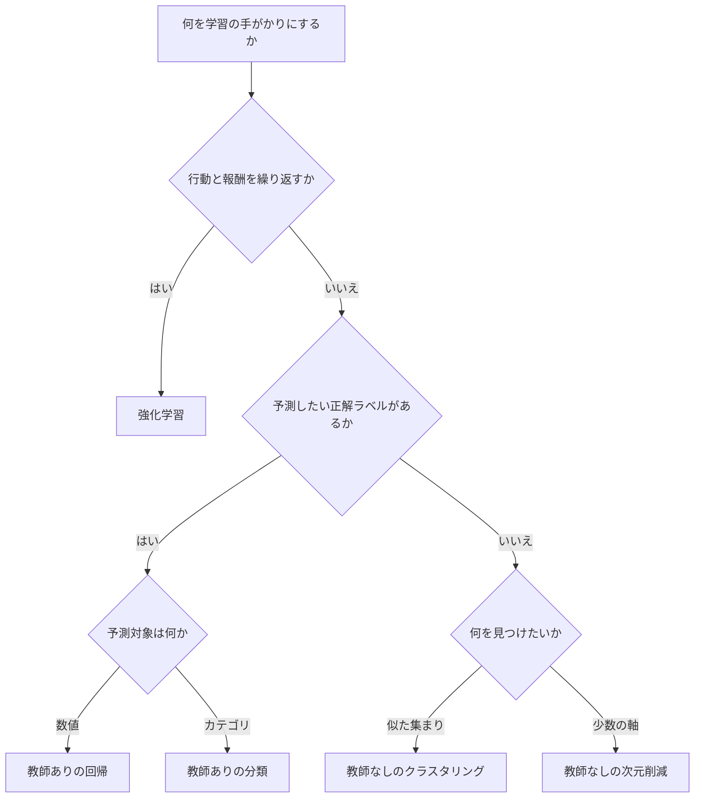

機械学習とは「データからパターンを自動的に学習して、予測や判断を行うAI技術の総称」だ。

G検定・DS検定では機械学習の<strong>種類・代表アルゴリズム・適用場面・評価指標</strong>の理解が問われる。

用語を覚えても、売上予測と顧客のグループ分けで迷うことがある。この記事では「何を学習の手がかりにするか」と「どんな誤りを減らしたいか」から、学習方式と評価指標を選べるように整理する。

---

## 機械学習の3種類

### 教師あり学習（Supervised Learning）

<strong>正解ラベル付きのデータを使って学習する</strong>方法だ。

「入力→正解」のペアを大量に与え、未知の入力に対して正解を予測できるようにする。

| タスク | 説明 | 代表例 |
|------|-----|------|
| 回帰（Regression） | 連続した数値を予測する | 住宅価格予測・売上予測・気温予測 |
| 分類（Classification） | カテゴリを分類する | スパムメール判定・画像分類・疾病診断 |

<strong>主なアルゴリズム：</strong>
- 線形回帰：入力と出力の線形関係を学習する
- ロジスティック回帰：分類問題に使う。名前に「回帰」とあるが分類に使う点に注意
- 決定木：条件分岐のツリー構造で分類・回帰を行う
- ランダムフォレスト：複数の決定木を組み合わせる。分類では多数決、回帰では予測値の平均などを使う
- SVM（サポートベクターマシン）：分類では、境界と最も近いデータとの余裕（マージン）を大きくする

分類・回帰と代表手法の整理は、[scikit-learn公式：教師あり学習](https://scikit-learn.org/stable/supervised_learning.html)でも確認できる。

### 教師なし学習（Unsupervised Learning）

<strong>正解ラベルなしのデータからパターンを発見する</strong>方法だ。

データの中に潜む構造・グループ・特徴を自動的に発見する。

| タスク | 説明 | 代表例 |
|------|-----|------|
| クラスタリング | 似たデータをグループに分ける | 顧客セグメンテーション・文書分類 |
| 次元削減 | 多次元のデータを低次元に圧縮する | データの可視化・特徴抽出 |
| 異常検知 | 通常パターンから外れたデータを検出する | 不正取引検知・設備異常検知 |

<strong>主なアルゴリズム：</strong>
- k-meansクラスタリング：k個のクラスター中心を繰り返し更新してグループ分け
- PCA（主成分分析）：分散が最大になる方向に次元を圧縮する
- オートエンコーダ：入力→圧縮→復元の構造で特徴を学習する（ディープラーニングの一種）

ラベルを使わないクラスタリングや次元削減などの整理は、[scikit-learn公式：教師なし学習](https://scikit-learn.org/stable/unsupervised_learning.html)を参照。異常検知はラベル付きで学ぶ場合もあり、目的名だけで教師なしと決めない。

### 強化学習（Reinforcement Learning）

<strong>エージェントが環境と相互作用しながら、報酬を最大化する行動を学習する</strong>方法だ。

正解データは与えられず、「試行錯誤で最適な行動方針を学ぶ」。

| 要素 | 説明 |
|-----|-----|
| エージェント | 学習・行動する主体（例：ゲームのAI・ロボット） |
| 環境 | エージェントが行動する空間 |
| 状態 | 現在の状況の表現 |
| 行動 | エージェントが選択できる操作 |
| 報酬 | 行動の結果として得られる数値的フィードバック |

<strong>活用例：</strong>
- AlphaGo・AlphaZero（囲碁・将棋AI）
- ロボットの歩行制御
- 自動運転の経路選択
- ChatGPTのRLHF（人間のフィードバックによる強化学習）

## 機械学習の選択基準

「どのアルゴリズムをいつ使うか」の判断がG検定・DS検定で問われる。



この図は代表的な使い分けの入口だ。「人が教えるか」ではなく、入力に対する正解・データの構造・行動後の報酬のどれを手がかりにするかを見る。試験で扱う範囲は[JDLAのG検定シラバス](https://www.jdla.org/certificate/general/#syllabus)で確認する。

## モデルの評価指標

### 混同行列（Confusion Matrix）

分類問題の評価に使う基本ツールだ。

| | 予測：正 | 予測：負 |
|---|:---:|:---:|
| 実際：正 | TP（真陽性） | FN（偽陰性） |
| 実際：負 | FP（偽陽性） | TN（真陰性） |

### 主要な評価指標

| 指標 | 計算式 | 重視する場面 |
|-----|------|-----------|
| <strong>正解率（Accuracy）</strong> | (TP+TN)/(全体) | クラスが均等に分布している場合 |
| <strong>適合率（Precision）</strong> | TP/(TP+FP) | 偽陽性を減らしたい（スパム誤判定を減らす等） |
| <strong>再現率（Recall）</strong> | TP/(TP+FN) | 偽陰性を減らしたい（疾病の見逃しを防ぐ等） |
| <strong>F1スコア</strong> | 2×Precision×Recall/(P+R) | 適合率と再現率のバランスを取りたい |

上の式は、どちらを陽性とするかを決めた二値分類の整理だ。[scikit-learn公式：分類の評価指標](https://scikit-learn.org/stable/modules/model_evaluation.html#classification-metrics)

<strong>正解率だけでは評価できない場合がある。</strong>

例えば99%が健常者のデータで「全員健常者」と予測すると正解率99%になるが、疾病を1例も発見できない。再現率が0%というのが実態だ。

見逃しを減らすなら再現率、陽性と判断したものの誤りを減らすなら適合率を重視する。ただし、一方だけを上げれば十分とは限らない。誤検知への対応負担も確認し、何を陽性と呼ぶか、どちらの誤りの影響が大きいかを先に決める。

### 回帰の評価指標

| 指標 | 内容 |
|-----|-----|
| RMSE（平均二乗誤差の平方根） | 予測値と実測値の差の大きさ。単位が元データと同じで解釈しやすい |
| MAE（平均絶対誤差） | 差の絶対値の平均。外れ値の影響を受けにくい |
| R²（決定係数） | 最良は1。平均値を予測する基準より悪いと負になることもある |

R²を「必ず0〜1」と覚えないことが重要だ。[scikit-learn公式：決定係数](https://scikit-learn.org/stable/modules/generated/sklearn.metrics.r2_score.html)

## 過学習・汎化性能・クロスバリデーション

### 汎化性能とは

訓練データだけでなく、<strong>未知のデータに対しても高い精度を示す能力</strong>だ。

過学習（訓練データへの過度な適合）を防ぎ、汎化性能を高めることが機械学習の核心的な課題だ。

### クロスバリデーション（交差検証）

データを複数のブロックに分割し、順番に検証データとして使いながら学習と評価を繰り返す手法だ。

データが少ない場合でも、汎化性能を安定して評価できる。

## ディープラーニング｜多層のニューラルネットワークで学ぶ

ディープラーニングは、多層のニューラルネットワークを使って、データからパターンを自動的に学習する技術だ。G検定では、実装ではなく動作原理の概念的な理解が問われる。学習方式とは別の軸で、教師あり・教師なし・強化学習と組み合わせて使う。上で挙げたオートエンコーダも、その例だ。

### ニューラルネットワークの構造

人間の脳の神経細胞（ニューロン）の接続を模した数学的なモデルだ。

```
入力層 → 中間層（隠れ層）× N → 出力層
```

- <strong>入力層</strong>：データを受け取る（画像なら各ピクセルの値）
- <strong>中間層（隠れ層）</strong>：パターンを抽出する。層が深いほど複雑な特徴を学べる
- <strong>出力層</strong>：予測結果を出す（例：「猫：90%」「犬：10%」）

「ディープ」とは、中間層が多層であることを指す。ニューロンの間の接続には<strong>重み</strong>があり、学習とは、訓練データに正しい出力を出させるように、重みを調整することだ。

### 活性化関数

ニューロンが受け取った信号を、次の層にどう伝えるかを決める変換関数だ。これがないと、層を重ねても線形変換にしかならない。

| 関数名 | 特徴 | 主な用途 |
|------|-----|--------|
| sigmoid | 出力を0〜1に圧縮。確率の表現に向く | 二値分類の出力層 |
| tanh | 出力を-1〜1に圧縮。0を中心にして学習が安定 | 中間層（古い手法） |
| ReLU | 0以下は0、正の値はそのまま出す。計算が速く、勾配消失を軽減 | 中間層の主流 |
| softmax | 複数クラスの確率を、合計1で出力する | 多値分類の出力層 |

### バックプロパゲーション（誤差逆伝播法）

学習は、「予測、誤差の計算、重みの修正」の繰り返しだ。

```
1. 順伝播：入力データを前向きに流して、予測値を出す
2. 誤差計算：予測値と正解の差（損失）を計算する
3. 逆伝播：誤差を後ろ向きに伝えて、各重みの修正量を計算する
4. 重みの更新：勾配降下法で重みを更新する
```

<strong>バックプロパゲーション</strong>は、ステップ3の「誤差を後ろ向きに伝える計算」を指す。損失を最小にする更新方法が<strong>勾配降下法</strong>で、傾きの向きに少しずつ谷を降りるイメージだ。更新の幅を決める係数が<strong>学習率</strong>で、大きすぎると収束せず、小さすぎると学習が遅くなる。

### 勾配消失問題と、過学習の対策

深いネットワークでは、誤差を逆伝播させる途中で勾配が極端に小さくなり、入力層に近い層がほとんど学習できなくなる。これを<strong>勾配消失問題</strong>という。

| 問題 | 対策 | 内容 |
|-----|-----|-----|
| 勾配消失 | ReLUの使用 | sigmoidやtanhから置き換えて改善する |
| 勾配消失 | バッチ正規化 | 各層の入力を正規化して勾配を安定させる |
| 勾配消失 | 残差接続（ResNet） | 入力を後の層にそのまま足し込み、深い層を可能にする |
| 過学習 | Dropout | 学習中にランダムにニューロンを無効にする |
| 過学習 | L1／L2正則化 | 重みが大きくなりすぎないよう、ペナルティを加える |
| 過学習 | データ拡張 | 画像なら、回転・反転・トリミングで訓練データを増やす |
| 過学習 | Early Stopping | 検証データの誤差が増え始めたら、学習を止める |

### 代表的なネットワーク構造

| 構造 | 得意なデータ | 特徴 |
|-----|-----|-----|
| CNN（畳み込みニューラルネットワーク） | 画像 | 畳み込み層でエッジや模様などの局所的な特徴を取り出し、プーリング層で情報を圧縮する。画像分類、物体検出、顔認識に使う |
| RNN（再帰型ニューラルネットワーク） | 時系列データ、テキスト | 前の時刻の隠れ状態を次の時刻に引き継ぎ、文脈を保つ。現在は、多くの場面でTransformerに置き換わっている |
| Transformer | 自然言語 | Self-Attentionで、文中の単語どうしの関係を並列に計算する。ChatGPTなどの大規模言語モデル（LLM）の基盤技術 |

## AI活用プロンプト

### アルゴリズムの使い分けを練習する

```
G検定・DS検定の機械学習で、アルゴリズムの選択を練習したいです。

以下の5つのビジネス課題に対して「どの機械学習アルゴリズムを使うか」
を答えてください。答えと理由も教えてください:

1. 過去3年間の月次売上データから翌月の売上を予測したい
2. 顧客10万人を購買行動の類似度でグループ分けしたい
3. 受信メールがスパムかどうかを自動判定したい
4. 工場の振動センサーデータから設備の異常を検出したい
5. 囲碁AIが最善手を学習したい

各課題について: 使うべき手法・アルゴリズム名・その理由を説明してください。
```

<!-- AI_EXAMPLE: 使うAI=普段使う生成AI / プロンプト=アルゴリズムの使い分けを練習する / 見せたいこと=特に異常検知でラベルの有無を確認し、課題名だけで一つの手法に決めつけないか -->

<!-- LEARNER_NOTE: 候補=分析の目的と正解ラベルを整理すると、AIの手法選択の説明がどう変わったか / 種類=think / 筆者の分析またはAI使用の実体験で記入。G検定の受験体験は書かない -->

### ディープラーニングの理解を自分の言葉で確かめる

```
G検定に向けて、ディープラーニングの理解を確認したいです。
私が理解した内容を説明するので、論理的な誤りや不足点を指摘してください。

「ディープラーニングとは、多層のニューラルネットワークを使って、
入力データから出力を予測するモデルを訓練する技術です。
学習は、順伝播で予測を出し、その誤差をバックプロパゲーションで
逆向きに伝えて、重みを更新することで行われます」

この説明の正確さを評価し、G検定で問われる重要な補足があれば追加してください。
```

技術・数理・活用を章ごとに結び付けたいときは、[G検定の20時間コース](/course/g-kentei/)で関連する節を確認できる。

---

## まとめ

機械学習の3種類で押さえる核心：

<strong>教師あり学習＝正解ラベルあり、回帰か分類か</strong>——問題の種類で使うアルゴリズムが変わる。

<strong>教師なし学習＝ラベルなし、グループか圧縮か</strong>——k-means・PCAの目的を説明できれば試験で対応できる。

<strong>強化学習＝試行錯誤で報酬最大化</strong>——ゲームAI・RLHF（ChatGPT等）が実例として使える。

<strong>評価指標は正解率だけじゃない</strong>——医療診断なら再現率、スパムフィルタなら適合率、という使い分けの根拠を説明できる状態にする。

<strong>ディープラーニングは「重みを調整して学習する」</strong>——活性化関数はReLUが中間層の主流、バックプロパゲーションは誤差を後ろに伝えて重みを直す手順、過学習の対策はDropout・正則化・Early Stopping。

→ [G検定 合格ロードマップに戻る](/method/g-kentei-hub/)

→ [DS検定 合格ロードマップに戻る](/method/ds-kentei-hub/)
