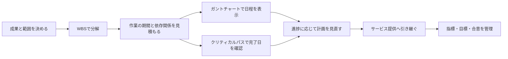

<!-- TARGET_KW: WBS ガントチャート クリティカルパス 違い -->
<!-- READER: S3-義務-学習中 / 検索 ｜ IT基礎の管理用語を混同する社会人 -->
<!-- ANSWER: 作業範囲・時間軸・完了日を制約する経路の違いで使い分ける -->
<!-- TAKEAWAY: 図の役割、並行経路の計算、運用指標と目標と合意の区別 -->

WBSもガントチャートも作業を書き出すものに見えて、違いが曖昧になっていませんか。見分ける軸は図の形だけでなく、「作業の範囲」「日程」「全体を遅らせる経路」のどれを知りたいかです。

この記事では、小さなWebサイトの制作と運用を例に、用語の役割をつなぎます。並行作業の計算とSLAの読み方まで確認し、場面ごとに使う道具を選べるようにします。

## 作る活動と、使い続ける活動を分ける

Webサイトを公開するまでの活動には、完成させる成果と区切りがあります。一方、公開後も利用者が使える状態を保つには、問い合わせや障害への継続した対応が必要です。

前者の計画にWBS・見積り・ガントチャート・クリティカルパスを使い、後者の品質をSLI・SLO・SLAで整理すると、役割を区別できます。運用中の改修もプロジェクトになり得るため、単純に「公開前か後か」だけで決めず、何を管理する活動かを見ます。

| 知りたいこと | 使うもの | それだけでは決まらないこと |
| --- | --- | --- |
| 完成に必要な範囲に漏れがないか | WBS | 作業の順番や終了日 |
| いつ始め、いつ終える予定か | ガントチャート | 横棒だけでは分からない依存関係 |
| どの作業が全体の終了日を制約するか | クリティカルパス | すべてのリスクへの対応 |
| 提供中の品質をどう測り、どこまで目指し、何を約束するか | SLI・SLO・SLA | 作業を誰に何日で割り当てるか |

それぞれが受け渡す情報は、次のようにつながります。



## WBSは、完成させる範囲を小さく分ける

Webサイトなら「公開するサイト」を、ページ、入力フォーム、利用ガイドなどの成果物へ分けます。さらに、担当や見積りを決められる単位まで具体化します。

WBS（作業分解構造）は、成果物を軸にプロジェクトの作業範囲を階層的に分解するものです。下位の範囲を合わせると上位の全範囲になるという100%ルールがあり、範囲外の作業も混ぜません。[PMI・WBSの定義と100%ルール](https://www.pmi.org/learning/library/practice-standard-work-breakdown-structures-8063)

次は説明用の分解例です。

- 公開するWebサイト
  - 公開用ページ：原稿・画面・表示確認
  - 問い合わせフォーム：入力画面・送信処理・動作確認
  - 運用資料：更新手順・問い合わせ先

「デザイン」の一語だけで、何を完成とするか分からないなら、見積りに使うには粗すぎます。ただし、細かく分けるほど正確になるわけでもなく、管理できる粒度にします。

ここでは、まだ「どの作業を先にするか」は決めていません。日程を作るには期間と順番が必要です。

## 見積りで、工数と期間を混同しない

工数は投入する作業量、期間は開始から完了までの長さです。10人日と見積もっても、確認待ちや並行できない工程があれば、二人で必ず5日とはいえません。

| 見積りの材料 | 手法の考え方 | 確かめる条件 |
| --- | --- | --- |
| 似た案件の実績 | 類推して概算する | 規模や条件の差を調整したか |
| 機能の種類・数・複雑さ | ファンクションポイントなどで規模を評価する | 工数へ換算する生産性の根拠があるか |
| コード量の見込み | ステップ数などから工数へ換算する | 言語や開発条件が比較可能か |
| 楽観・最頻・悲観の期間 | 三点の見積りで幅を扱う | どの平均の式を使うか |

三点見積りのうち、PERT型の加重平均を使う例では、`(楽観値 + 4 × 最頻値 + 悲観値) ÷ 6`と計算します。三つの値を使う方法すべてがこの式とは限らないため、設問の指定を優先します。[PMI・スケジューリングの標準資料](https://www.pmi.org/-/media/pmi/documents/public/pdf/certifications/practice-standard-scheduling.pdf)

たとえば楽観2日・最頻4日・悲観8日なら、`(2 + 4×4 + 8) ÷ 6 = 約4.33日`です。これは説明用の計算例で、実際の案件の推奨見積りではありません。

期間の見込みが出たら、次は並行できる作業と待ち合わせを確認します。

## ガントチャートは日程、クリティカルパスは完了日の制約を見る

ガントチャートは、作業を縦、時間を横に並べ、作業の期間を横棒で表します。「今週どの作業が動くか」を読みやすい一方、横棒だけでは先行作業の条件を取り違えることがあります。

依存関係の線を重ねたガントチャートもあります。「ガントチャートでは依存関係を表せない」とは言い切れません。

クリティカルパスは、作業のつながりと所要期間から、プロジェクトの最短完了期間を制約する経路を求める考え方です。単純な日程ネットワークでは、開始から終了までの所要時間が最長の経路を探します。[PMI・クリティカルパスの計算](https://www.pmi.org/learning/library/critical-path-method-calculations-scheduling-8040)

### 並行する二経路を計算する

次の条件は、計算練習のための架空の例です。人員は足りており、待ち時間や休日は考えず、各作業は先行作業の完了直後に始められるとします。

| 作業 | 所要日数 | 開始できる条件 |
| --- | --- | --- |
| A：要件確認 | 3日 | 最初に開始 |
| B：ページ作成 | 5日 | Aの終了後 |
| C：公開資料の準備 | 2日 | Aの終了後。Bと並行可 |
| D：公開確認 | 4日 | BとCの両方が終了後 |

経路はA→B→Dが12日、A→C→Dが9日です。DはBとCの遅い方を待つため、全体の最短完了期間は12日になります。

この条件ではA→B→Dがクリティカルパスで、Cには3日の余裕があります。Cが4日になっても全体は12日ですが、6日になればA→C→Dの13日が全体を制約します。

「最短で終わる日を知りたいから最短の経路を選ぶ」とすると、待ち合わせを見落とします。短縮したいときは、現在の最長経路を短くする必要があります。

## リスク対応は、何を変えるかで判別する

「未経験の技術を使う」という架空のリスクでも、取る行動によって分類が変わります。

| 行動の条件 | 対応 | 例 |
| --- | --- | --- |
| 原因となる選択そのものをやめる | 回避 | 既存技術へ変更する |
| 発生の可能性や影響を小さくする | 軽減 | 小規模な試作で問題を先に確認する |
| 負担の一部を第三者へ移す | 移転 | 契約で特定の損失負担を分ける |
| 残るリスクを認識して引き受ける | 受容 | 予備費や発生後の対応方針を決める |

外部委託しただけで、発注側の責任やリスクがすべてなくなるわけではありません。何を誰が負担する契約なのかまで見ます。

## SLA・SLO・SLIは、合意・目標・測定の違い

公開後に「使えるサービスか」を確かめるには、測り方と目標を決めます。GoogleのSRE資料では、SLIは品質を測る指標、SLOはその目標、SLAは達成・未達時の扱いを伴う利用者との合意として区別されています。[Google SRE・Service Level Objectives](https://sre.google/sre-book/service-level-objectives/)

次は関係を理解するための架空の例です。

| 用語 | 確かめる問い | 例 |
| --- | --- | --- |
| SLI | 何を、どう測るか | 対象となるHTTP要求のうち正常応答した割合 |
| SLO | どこまでを目標にするか | 同じ対象・集計期間で正常応答99.9%以上 |
| SLA | 利用者と何を合意したか | 対象範囲・目標・除外条件・未達時の扱いの合意 |

SLOが必ず社内専用というわけではなく、SLAに返金が必ず含まれるとも限りません。数値だけを比べず、合意内容を読みます。

たとえば一か月を30日・24時間の連続稼働と仮定し、時間ベースで稼働率99.9%を考えると、停止に使える時間は`30×24×60×0.001 = 43.2分`です。HTTP要求の成功割合で測るSLIとは分母が異なるため、そのまま置き換えられません。

## AIには、自分の説明の抜けを確認してもらう

用語を一通り読んだら、先ほどのA〜Dについて自分で計算し、理由を説明してみます。AIは専任講師に質問するように、理解の穴を探す相手として使えます。

```text
WBS・ガントチャート・クリティカルパスの違いを確認したいです。
私の説明：[自分の言葉で記入]
架空の工程：Aは3日、Bは5日でA待ち、Cは2日でA待ち、Dは4日でBとC待ち。
人員は十分でBとCは並行でき、待ち時間や休日はありません。
まず私の説明で、作業範囲・日程・依存関係を混同している箇所を指摘してください。
次に二つの経路の合計と、Dが開始できる時点を計算して示してください。
最後にCが6日に延びたら何が変わるか、私に一問だけ質問して返答を待ってください。
```

<!-- AI_EXAMPLE: 使うAI=Claude / プロンプト=本文「AIには、自分の説明の抜けを確認してもらう」 / 見せたいこと=自分の説明への指摘、12日と9日の比較、C変更後の問いを筆者が実行して記録 -->

<!-- LEARNER_NOTE: 候補=上のプロンプトを実行して、経路の計算と待ち合わせの説明を比較した気づき。受験体験は不可 / 種類=think / 筆者の実体験で記入 -->

2027年度からの新制度については、2026年11月時点でシラバス案が公表されています。現行試験の用語説明と、新試験での出題範囲・深さは分けて確認してください。[IPA・新試験制度のシラバス案](https://www.ipa.go.jp/shiken/syllabus/henkou/2026/20260630.html)

---

## まとめ

WBSは範囲を分け、ガントチャートは時間軸を示し、クリティカルパスは全体の完了日を制約する経路を探します。運用の品質では、SLIの測り方、SLOの目標、SLAの合意内容を分けて読みましょう。

学ぶ順序は[ITパスポートの合格ロードマップ](/method/itp-hub/)で確認できます。基礎の確認は[ITパスポート第4章](/course/ip/04-service-project-management/)、運用管理との接続は[SG第6章](/course/sg/06-management/)へ進んでください。
