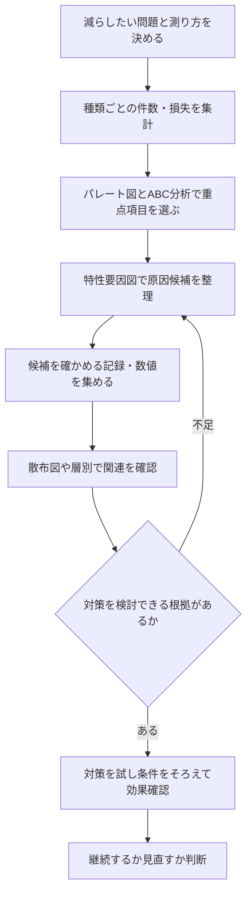

改善の対象を絞りたいのか、原因の候補を出したいのか、二つの数値の関連を見たいのか。目的が違えば、同じデータでも使うQC手法は変わります。

ABC分析・特性要因図・散布図を、架空の問い合わせ100件を改善する場面でつなぎます。読み終えると、次に必要な図と、その図だけでは結論にできないことを区別できます。

## ABC分析とパレート図を区別する

パレート図は、分類した件数や損失額を大きい順に並べた棒と、累積構成比の線を組み合わせる図です。QC七つ道具の一つとして位置づけられています。[日本科学技術連盟・QC手法](https://www.juse.or.jp/service_solution/qc_story/index.html)

<strong>ABC分析は、重要度に応じて項目をA・B・Cに分け、管理の優先順位を決める手法</strong>です。パレート図を使って分類できますが、ABC分析という図がQC七つ道具に別途含まれるわけではありません。

件数を減らす目的なら件数で、損失を抑える目的なら金額で並べます。件数が少なくても重大事故につながる項目は、頻度とは別に優先する判断が必要です。

まず、何の合計に対する割合かを決めてから、数字を計算しましょう。

## 問い合わせ100件から重点項目を選ぶ

次は学習用の架空データです。問合せの種類ごとの件数を並べ、ここでは「累積80%までをA、次の95%までをB、残りをC」とする練習上のルールを置きます。

| 問い合わせの種類 | 件数 | 構成比 | 累積構成比 | この例の分類 |
|---|---:|---:|---:|---|
| ログインできない | 45 | 45% | 45% | A |
| 決済できない | 35 | 35% | 80% | A |
| 表示が崩れる | 15 | 15% | 95% | B |
| その他 | 5 | 5% | 100% | C |

累積構成比は、上からの件数の合計を全体の100件で割ります。上位2種類の合計が80件なので、この例ではAに分類します。

「100件のうち上位20件を解決すれば80件減る」という意味ではありません。並べる単位は問い合わせの<strong>種類</strong>、足し合わせる値はその種類の<strong>件数</strong>です。

境界の80%・95%はこの練習の設定で、普遍的な決まりではありません。設問に境界や境界をまたぐ項目の扱いが示されていれば、それに従います。

重点項目が選べても、なぜ発生するかはまだ分かりません。そこで原因候補を整理します。

## 特性要因図は、原因の候補を広げる

特性要因図（フィッシュボーン図）は、結果となる特性と、その要因の関係を系統的に整理する図です。図へ書き込んだだけで原因が実証されるわけではありません。[厚生労働省・分析手法の資料](https://www.mhlw.go.jp/content/11800000/000701102.pdf)

ログイン失敗が多いなら、「利用者の操作」「サーバーの状態」「アカウント情報」「案内の方法」のように視点を分けます。製造業で使う4M（人・機械・材料・方法）を、対象の業務に合わせて読み替える方法です。

たとえば、「パスワードの案内が曖昧」「認証サーバーが混雑」「失効したアカウントが残る」を候補として挙げます。すべてを原因と断定せず、確かめる記録や測定値を対応づけます。

原因候補を出した後は、それを数値や記録で検討できる形にします。

## 散布図は、対になった数値の関連を見る

散布図は、同じ対象から得た二つの数値を横軸と縦軸に取り、組ごとに点を打つ図です。たとえば各時間帯の「ログイン試行数」と「失敗率」を対にして並べます。[経済産業省・QC七つ道具の定義を含む試験資料](https://www.meti.go.jp/policy/economy/hyojun/techno_infra/00_download/R4_06kanri.pdf)

右上がりなら正の関連、右下がりなら負の関連がある可能性を読み取ります。直線的な傾向が見えなくても、曲線的な関係や、別グループが混ざっている可能性は残ります。

試行数の多い時間帯に失敗率が高くても、「混雑が原因」とはまだ確定しません。新規利用者が多い時間帯だったなど、別の条件が関係する場合があります。

散布図は仮説を検討する材料です。対策の効果を測るときは、失敗の定義、試行数、測定期間などもそろえて比較します。

## どの図へ進むかを決める流れ



これは使い分けの一例です。数値が対になっていない原因候補なら、無理に散布図にせず、記録の確認や条件別の比較を選びます。

| 現在の問い | 選ぶ手法・行動 |
|---|---|
| どの種類から改善するか | 件数・損失でパレート図を作り、ABC分析などで優先順位を決める |
| 原因の候補が偏っていないか | 特性要因図で視点を広げる |
| 対になった二つの数値に関連があるか | 散布図で形・外れ値・グループの混在を見る |
| 施策が効いたか | 条件をそろえた前後比較や比較群で、ほかの変化も点検する |

<!-- LEARNER_NOTE: 候補=ABC分析の項目数と件数・累積構成比を混同した箇所 / 種類=think / 筆者の実体験で記入 -->

## AIでは、原因候補と検証方法を分ける

AIに候補を挙げてもらうときも、答えを事実として扱わず、どのデータで確かめるかをセットにします。

```text
架空のWebサイトで、ログイン失敗の問い合わせが多いとします。
特性要因図を作る前の練習として、人・機械・データ・手順の観点から
原因候補を一つずつ挙げてください。原因は断定しないでください。
各候補に「確認する記録」と「関連があっても因果と断定できない理由」を添えてください。
最後に、私が追加で調べるべき条件を一つ質問してください。
```

<!-- AI_EXAMPLE: 使うAI=Gemini / プロンプト=本文のログイン失敗の原因候補と確認記録の整理 / 見せたいこと=原因候補と実証済みの原因を分け、散布図が使えるデータを選ぶ回答 -->

## まとめ

ABC分析は重点項目の分類、特性要因図は原因候補の整理、散布図は二つの数値の関連の確認です。パレート図との区別と、相関だけでは原因を確定できない点を押さえましょう。

[ITパスポート学習コース](/course/ip/)の問題で、問われているのが「選定・候補出し・関連確認」のどれかを見分けてください。全体の学習順は[ITパスポート合格ロードマップ](/method/itp-hub/)へ進めます。
