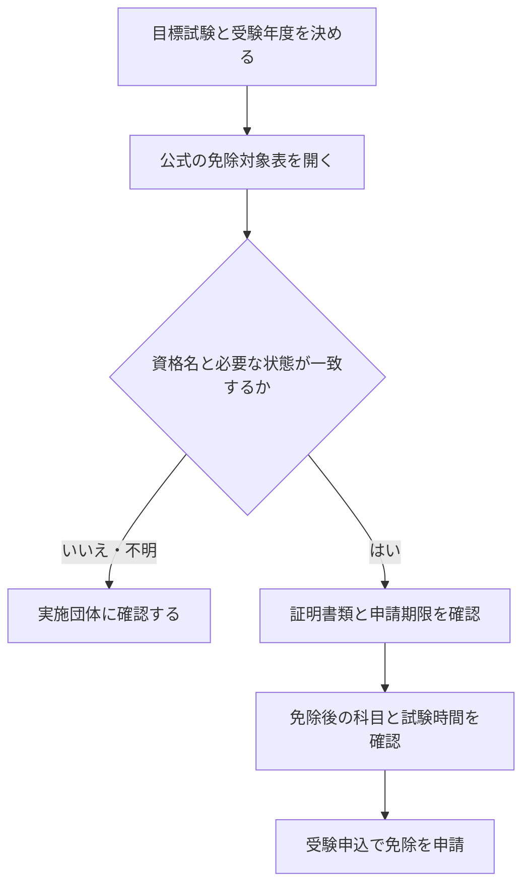

<!-- TARGET_KW: 資格 科目免除 他資格 組み合わせ -->
<!-- READER: S3-実利-検討前／検索・既得資格を次の受験に使いたい人 -->
<!-- ANSWER: 対象資格と状態・書類・期限を照合 -->
<!-- TAKEAWAY: 学習重複と免除の違い・確認フロー -->

資格の科目免除一覧を探していても、「分野が似ている」という説明だけでは、自分が申請できるか決められません。

分かれ目は、保有する資格名だけでなく、合格・登録・免状交付のどの状態が必要かと、目標試験の申請条件です。代表的な組み合わせを確認し、申込み前に書類までそろえる流れを整理します。

## 科目免除と学習内容の重複は別のもの

すでに知っている分野なら勉強を省けることはありますが、それだけで受験科目がなくなるわけではありません。科目免除は、目標試験が定めた条件と申請に従う制度です。

たとえば中小企業診断士では、他資格等の保有による免除と、その試験で科目合格したことによる免除が別に案内されています。科目合格の免除は翌年度・翌々年度などの条件があり、申請しなければ免除になりません。[試験実施団体・FAQ](https://jns1.j-smeca.jp/contents/013_c_faq/001_faq_shiken.html)

まず今回確認したいのが「他資格による免除」なのか「過去の科目合格」なのかを分けましょう。次の一覧は前者の代表例です。

## 他資格保有による科目免除の代表一覧

2026年10月時点の公式掲載情報です。網羅的な一覧ではなく、目標試験の案内で最終確認するための入口です。

| 保有資格・状態 | 目標試験・免除の例 | 確認すべき条件・一次情報 |
| --- | --- | --- |
| 応用情報技術者試験の合格 | 中小企業診断士第1次「経営情報システム」 | 正式な試験区分名・証明書類。[他資格等保有による免除情報](https://www.shindan-shi.jp/103/menjo.html) |
| 公認会計士・会計士補等、公式表に記載の状態 | 中小企業診断士第1次「財務・会計」 | 資格・試験合格等の区分と証明書類。[免除対象表](https://www.shindan-shi.jp/103/menjo.html) |
| 弁護士・司法試験合格者等、公式表に記載の状態 | 中小企業診断士第1次「経営法務」 | 対象となる合格・登録の区分。[免除対象表](https://www.shindan-shi.jp/103/menjo.html) |
| 電気工事士・電気主任技術者・既得の消防設備士免状など | 消防設備士の試験科目の一部 | 受ける類と保有資格で範囲が変わる。甲種特類には科目免除なし。[消防試験研究センター・科目一覧](https://www.shoubo-shiken.or.jp/shoubou/annai/subject.html) |

応用情報などの合格による他試験の優遇措置は、[IPAの案内](https://www.ipa.go.jp/shiken/about/merit/merit07.html)にもあります。ただし、一方の試験の案内だけで申請を終えず、受ける側の年度別案内を確認してください。

「合格したから次の免除に間に合う」とは限りません。消防設備士の既得免状による免除では、申請時までに免状の交付を受けている必要があります。[消防試験研究センター・免除FAQ](https://www.shoubo-shiken.or.jp/faq/index_shoubou.html)

この違いが、資格を取る順番を決める際の確認点になります。

## 合格・免状・申請期限を順に確認する

次の流れで、自分の条件を目標試験の案内に照合します。



| 自分の状態 | 次にすること |
| --- | --- |
| 正式名称が表と一致しない、旧区分名で合格した | 自己判断で読み替えず、対象一覧と窓口で確認する |
| 合格したが登録・免状交付がまだ | 免除に必要な状態と、申込期限までの手続き日数を確認する |
| 書類がそろわない | 発行窓口・所要日数を確認し、期限に間に合うか判断する |
| 免除条件を満たしている | 免除後の受験科目・時間・合否基準も確認する |
| 新試験制度へ移行する年度を受ける | 現行制度の免除がそのまま続くと決めず、新年度案内を待つ |

科目が免除されても、その科目を満点として加算する仕組みとは限りません。中小企業診断士では免除科目は合否判定の対象外です。[実施団体・科目免除のFAQ](https://jns1.j-smeca.jp/contents/013_c_faq/001_faq_shiken.html)

免除のためだけに別資格を先に取る場合は、短縮できる学習と、追加する受験・登録の負担を比較します。既に持っている資格を使えるか確認することと、免除を目的に新しい資格を増やすことは分けて考えましょう。

## AIには免除要項の該当箇所を整理させる

資格名だけを渡して候補を広く聞く方法は、確認先を探す入口に使えます。次はその方法を筆者が実行した記録です。

プロンプト例：

```text
私は[保有資格名]を持っています。
[目標資格名]の受験にあたり、一般的な傾向として科目免除や試験範囲の重複が制度化されている可能性があるか教えてください。
断定はせず、確認すべき公式の受験案内・実施団体名を具体的に挙げてください。
```

### ChatGPTで実行した結果

このプロンプトを、ChatGPT（有料プラン）で実行しました（2026年10月）。組み合わせは、免除制度が実際にある例として「応用情報技術者試験に合格 → 中小企業診断士を受験」を入れています。

```text
私は応用情報技術者試験に合格しています。
中小企業診断士の受験にあたり、一般的な傾向として科目免除や試験範囲の重複が制度化されている可能性があるか教えてください。
断定はせず、確認すべき公式の受験案内・実施団体名を具体的に挙げてください。
```

回答の最初は「応用情報の合格者は、中小企業診断士の第1次試験『経営情報システム』の科目免除を<strong>申請できる可能性がある</strong>」でした。続けて、「学習内容の重複」と「制度上の免除」を分けて説明していました（要約）。

| 観点 | 回答の説明 |
| --- | --- |
| 科目免除 | 他資格の保有にもとづく正式な制度。対象資格・対象科目・申請方法は公式案内で決まっている。自動では免除されないので、申請条件を確認する |
| 試験範囲の重複 | ITの基礎、システム開発、情報セキュリティなどは学習経験を活かせる。ただし、重なる内容がすべて免除されるわけではない |

確認先として挙がったのは、次の3つです。

- <strong>日本中小企業診断士協会連合会</strong>（試験の実施団体）：受験年度の「中小企業診断士第1次試験案内」の、他資格の保有による免除の項目。応用情報の記載、免除される科目、証明書類、申請期限を見る
- <strong>IPA（情報処理推進機構）</strong>：情報処理技術者試験の合格による、他の国家試験の一部免除をまとめたページ
- <strong>中小企業庁</strong>（制度の所管）：その年度の中小企業診断士試験についての案内

プロンプトで「断定はせず」と頼んだので、「可能性がある」「受験年度の案内で照合するのが確実」という言い方になっています。「免除される」と言い切らせないことで、確認先まで答えがそろいました。

応用情報の合格で「経営情報システム」が免除される制度は、実際にあります。申請には合格証書のコピーなどが必要で、申請しなければ免除になりません。最終的には、受験する年度の試験案内で確かめてください。


上記の応用情報から中小企業診断士への免除と証明書類は、[実施団体の対象表](https://www.shindan-shi.jp/103/menjo.html)でも確認してください。旧記録の回答を、将来の制度変更後にも有効な申請判定としては扱いません。

申請前には、公式資料の本文を渡す次の方法で確認項目を整理します。

```text
【受験年度・目標試験】
【保有資格の正式名・合格日・登録や免状交付の状態】
【公式受験案内の免除欄の本文・資料名・URL】
この文書だけを根拠に、条件／私の状態／該当箇所／未確認事項を表にしてください。
証明書類と申請期限の記載も探し、見つからなければ不明としてください。
記載がない他資格への読み替えや、免除できるという推測はしないでください。
```

<!-- AI_EXAMPLE: 使うAI=ChatGPT / プロンプト=本文の公式免除欄との照合 / 見せたいこと=合格と免状交付、書類と期限を分けて抽出できるか -->

<!-- LEARNER_NOTE: 候補=免除条件のAI抽出を原典と突き合わせた際の気づき / 種類=think / 筆者の実体験で記入 -->

AIに合格証書の氏名・番号などを入力する必要はありません。条件を照合するための資格名と状態に絞ります。

---

## まとめ

科目免除は、学習範囲が似ているかではなく、目標試験の公式条件に自分の資格と状態が一致するかで確認します。

一覧で組み合わせを見つけたら、必要な証明書類、申請期限、残る試験科目を一枚にまとめてください。持ち物も確認するなら、[試験の電卓持ち込み規定](/theory/shiken-dentaku-mochikomi-kitei/)で受験方式ごとの違いを整理できます。
