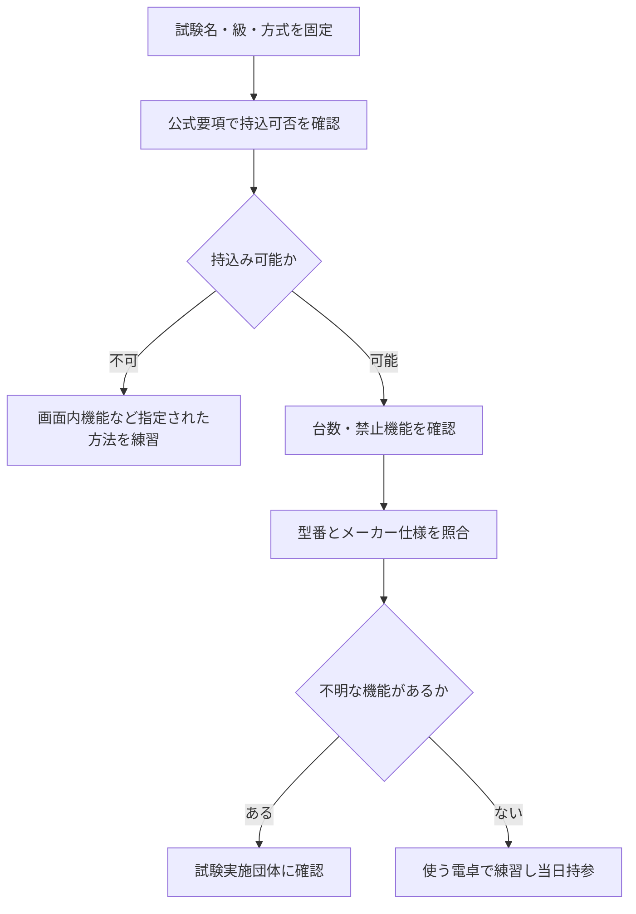

<!-- TARGET_KW: 試験 電卓 持ち込み 規定 -->
<!-- READER: S3-義務-直前／検索・手元の電卓の可否を確かめる人 -->
<!-- ANSWER: 試験・級・方式から機能を照合 -->
<!-- TAKEAWAY: 3試験の違いと型番確認フロー -->

いつも使っている電卓を、次の資格試験にも持っていってよいか迷っていませんか。

最初に確認するのは機種ではなく、試験名・級・受験方式です。CBTでも、日商簿記や電験三種と、FP2・3級では持込みの扱いが違います。

この記事では2026年10月時点の公式情報で比較し、手元の電卓を機能まで照合する順序を整理します。筆者は本記事で比較する日商簿記・FP・電験三種を未受験です。公式資料をもとに整理しています。

## 電卓持ち込み規定は試験名・級・方式で分ける

| 試験・方式 | 持込みの扱い | 準備すること |
| --- | --- | --- |
| 日商簿記2・3級のネット試験 | 規定に合う電卓を持参。パソコンの計算機能は使用不可 | 自分の電卓で練習する。[日本商工会議所・ネット試験FAQ](https://www.kentei.ne.jp/net-qa) |
| 日本FP協会の2・3級CBT | 電卓の持込み不可 | 画面内の電卓操作を確認する。[試験運営会社・持込みFAQ](https://cbt-s.com/examinee/jafp/detail/5535.html) |
| 電験三種のCBT | 電卓は1台のみ持込み可。機能制限あり | その期の受験案内で機能を照合する。[電気技術者試験センター・FAQ](https://www.shiken.or.jp/shiken/faq/faq01/000179.html) |

FPの画面内電卓は、[試験運営会社の利用方法](https://cbt-s.com/files/examination/17322383321.pdf)で操作を確認できます。手元の電卓とキーの位置や操作が同じだと思わず、使い方を確認してください。

この比較から分かるのは、「CBTだから持込み禁止」「計算問題があるから持込み可能」のどちらでも決められないことです。次に、持込み可能な試験だけ機能の照合へ進みます。

## 日商簿記で使える機能と使えない機能を照合する

日本商工会議所の2級注意事項では、印刷、メロディー、プログラム、辞書等の機能がある電卓は持込みできません。一方、日数計算、時間計算、換算、税計算、音の出ない検算は、プログラム機能に該当しないものとして使用が認められています。[日本商工会議所・試験科目と注意事項](https://www.kentei.ne.jp/bookkeeping/class2/exam)

つまり、ボタンが多いだけで不可とは決められません。また「当日は使わないからよい」とも限らず、禁止されている機能を搭載していないかを確認します。

| 電卓を見て分かったこと | 確認・判断のしかた |
| --- | --- |
| 関数や公式の記憶、辞書等の機能がある | 日商簿記の禁止機能の説明と照合し、規定に適合する別の電卓を準備する |
| 日数・時間・税計算のボタンがある | それだけで不可とせず、注意事項の許可される機能と照合する |
| メモリーという名称の機能がある | 数値の一時記憶と公式等の記憶を区別し、仕様を確認する |
| 型番しか分からない | メーカーの説明書で、搭載機能の正式名を調べる |
| 似た型番の合格者が使っていた | 自分の型番と受験する試験の最新規定を別に確認する |

上の機能基準は日商簿記についての整理です。電験三種などへ、そのまま適用する表ではありません。

電験三種では公式FAQに1台のみと明記されていますが、それだけでどの電卓も使えるわけではありません。FAQから対象期の受験案内へ進み、「電卓」の項目を照合します。[電気技術者試験センター・CBTの持込案内](https://www.shiken.or.jp/shiken/faq/faq01/000179.html)

## 購入・持参する前の確認手順

電卓を買う場合も、先に試験側の条件を固定します。商品ページの「試験向け」という説明だけで決めないようにします。

問い合わせる場合は、試験名・級・年度や期・方式、電卓の型番、気になる機能、メーカー説明書のURLをまとめます。「この電卓は使えますか」だけより、規定のどの条件で迷っているかを伝えられます。

受験前には、電源、キーの反応、画面表示を確認します。予備の電卓を持ち込む計画も、まず台数制限に照らしてください。

## 規定確認と計算練習を同じ電卓で進める

日商簿記のネット試験は自分の電卓、FP2・3級のCBTは画面内の電卓という違いを、学習の段階から反映します。いつもの計算方法がそのまま使えるとは考えず、本番で認められる操作に慣れておきます。

学習の全体像が必要なら、[日商簿記のハブ](/method/boki-hub/)、[FPのハブ](/method/fp-hub/)、[電験三種のハブ](/method/denken-hub/)から対象試験を選んで確認できます。

---

## まとめ

電卓持ち込み規定は、試験名・級・方式を固定して確認します。持込み可能なら台数と禁止機能、不可なら指定の計算方法を調べる順序です。

手元の電卓の型番と、受ける試験の公式要項を並べて確認してください。規定とメーカー仕様の対応が分からない機能は、購入・受験前に実施団体へ確認します。
