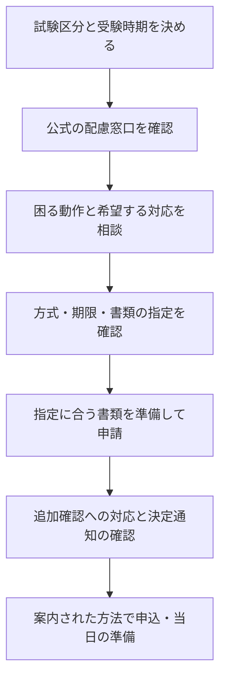

<!-- TARGET_KW: 試験 受験配慮 申請 / READER: S3-義務-検討前 / 検索 / ANSWER: 予約や診断書取得の前に実施団体へ困る動作と希望する対応を相談する / TAKEAWAY: CBTの配慮と別方式の区別、期限と書類の確認順 -->

試験中の服薬や画面の読み取りに不安があり、受験配慮を申請できるか迷っている人向けの記事です。

確認の出発点は、診断名だけでなく「通常の受験方法で何が難しいか」です。この記事では、申込前に相談する内容と書類準備の順番を整理します。

筆者は受験配慮の申請・特別措置試験の受験経験はありません。以下は公式情報をもとにした手続きの整理です。

## 受験配慮の相談と、希望どおりの決定は別

2024年4月から、民間事業者にも障害のある人への合理的配慮の提供が義務化されています。具体的な対応は、本人と事業者が話し合い、過重な負担に当たるかも踏まえて検討します。[政府広報オンライン・合理的配慮の提供](https://www.gov-online.go.jp/article/202402/entry-5611.html)

そのため、「申請すれば必ず別室や時間延長になる」とは言えません。最初の問い合わせでは、希望を一つに絞り込みすぎず、受験上の支障と必要な対応を伝えると確認事項を整理できます。

たとえば「長文を読むのが苦手」だけでなく、「画面の拡大を使って読みたい」「通常時間では読み取りが難しく、時間延長の申請条件を知りたい」と、困る場面と相談事項を分けます。これは相談の書き方の例であり、利用できる配慮の一覧ではありません。

## 通常のCBTでの配慮か、別方式の試験か

IPAは、通常のCBTで可能な範囲の配慮を行う方法と、身体の不自由等によりCBT方式で受験できない人向けのペーパー方式の特別措置試験を案内しています。[IPA・令和8年度後期特別措置試験「対象者」](https://www.ipa.go.jp/shiken/2026/r08kouki_tokubetsusochi.html)

| 自分の状況 | 先に確認すること | 判断した後の行動 |
|---|---|---|
| 配慮があればPCで受験できそう | 希望する対応を通常のCBT会場で利用できるか | 予約前の申請方法・対応会場を確認 |
| PC操作や画面での受験自体が難しい | 特別措置試験の対象と必要書類 | その実施回の要項を確認 |
| どちらが合うか分からない | 困る動作と希望を窓口に伝える | 窓口の案内に沿って方式を選ぶ |
| 申込後にけがなどの事情が生じた | 今の予約で対応可能か | 変更・追加申請の可否を窓口に確認 |

この表は相談先を選ぶための整理で、審査結果を予測するものではありません。他団体の試験にIPAの条件をそのまま当てはめないでください。

IPAの対象試験・書類・日程は[特別措置試験のガイド](/trend/cbt-tokubetsu-sochi-guide/)で確認できます。ここからは、どの団体にも問い合わせる前に整理しておきたい順番です。

## 受験配慮を申請する流れ

以下は準備のための流れ図です。実際の提出先・順番は、受ける試験の案内を優先してください。

IPAの案内には、CBTでの服薬や座席配慮、車いす対応会場などについて、受験申込前に申請する旨が記載されています。先に一般の会場を予約してから対応を求める順番にしないことが重要です。[IPA・受験上の配慮](https://www.ipa.go.jp/shiken/2026/r08kouki_tokubetsusochi.html)

診断書も、様式や発行日の指定を確認してから依頼します。「新しい診断書なら使える」と考えると、指定期間より前に発行してもらい、取り直しになるおそれがあります。

## 窓口に確認する内容を一枚にまとめる

問い合わせの際は、次の欄を埋めておくと、未確認の条件を見つけやすくなります。書類の正式な記載内容は実施団体の指定に従います。

| 確認項目 | 手元に残すメモ |
|---|---|
| 試験区分・実施回 | 試験名、年度、受けたい時期 |
| 困る場面 | 読み取り、入力、移動、服薬など、当日難しい動作 |
| 希望する対応 | 必要な理由、代替の対応を相談できるか |
| 期限と申込順序 | 配慮申請の期限、通常申込の期限、予約前の承認の要否 |
| 書類 | 指定様式、発行日の範囲、原本・写し、提出方法 |
| 決定後 | 利用できる会場、当日持参するもの、連絡先 |

回答を受けたら、担当窓口・確認日・回答内容を一緒に保存します。電話で分からなかった点は、問い合わせ番号や公式ページの該当箇所を示して再確認してください。

## まとめ

受験配慮の申請では、予約前に「困る動作 → 希望する対応 → 方式・期限・書類」の順で確認します。診断名や他人の体験だけで可否を決めず、受ける試験の窓口に相談してください。

まずは上の整理表のうち、試験区分・困る場面・希望する対応の3欄を書き出すと、最初の問い合わせを具体的にできます。
