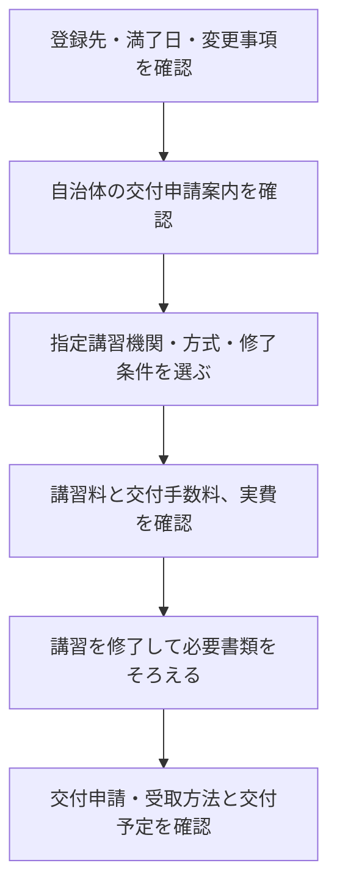

宅建士証の更新を調べると、「講習料12,000円」と「更新に16,500円」のように異なる金額が出てくることがあります。

確認するポイントは、講習だけの金額か、宅建士証の交付手数料まで含むかです。この記事では神奈川県の公式案内を例に、内訳と申請の状態を分け、自分の登録先で何を確かめるべきかを整理します。

## 宅建士証の更新費用は、講習料と交付手数料を分ける

2026年10月確認の神奈川県の例では、法定講習受講料12,000円と宅建士証交付申請手数料4,500円を合わせ、16,500円です。全国共通の一律価格としてではなく、実施団体と登録先の案内を照合するための具体例として見てください。[神奈川県宅建協会：法定講習](https://kanagawa-takken.or.jp/association/qualification/course/)・[神奈川県：宅建士証の交付申請](https://www.pref.kanagawa.jp/docs/u2h/cnt/f531874/p15665.html)

| 費用の項目 | 神奈川県の確認例（2026年10月） | 自分の手続きで確認すること |
|---|---|---|
| 法定講習受講料 | 12,000円 | 指定講習機関の受講料と教材の扱い |
| 交付申請手数料 | 4,500円 | 講習の申込金に含むか、別に払うか |
| 写真・郵送・決済等 | 利用する方法による | 必要な枚数、返送方法、支払い方法 |
| 交通・受講環境 | 会場受講かWEBかによる | 移動費、使える端末、受講に必要な時間 |

<strong>予算は「講習料＋交付手数料＋必要な実費」</strong>で見ます。勤務先が費用を負担するなら、領収書の宛名や精算条件も申し込み前に確認してください。

試験合格後の資格登録にかかる費用は、この更新費用には含めていません。次に、今の自分がどの申請に当たるかを分けます。

## 更新・初回交付・失効後の交付を区別する

宅建士証の有効期間は5年です。神奈川県では更新のための法定講習は満了日の6か月前から受講でき、受講後に交付申請を行います。[神奈川県：更新申請](https://www.pref.kanagawa.jp/docs/u2h/cnt/f531874/p15665.html)

| 現在の状態 | 手続きの方向 | 費用を確認する先 |
|---|---|---|
| 有効な士証があり、そのまま業務を続けたい | 有効期間内に法定講習と更新申請を行う | 登録先自治体と指定講習機関 |
| 有効期間が切れた | 期限切れの士証を持つ人の交付申請を確認する | 登録先自治体 |
| 初めて交付を受け、試験合格から1年以内 | 講習を要しない交付申請の案内を確認する | 登録先自治体 |
| 初めて交付を受け、試験合格から1年を超えた | 法定講習を伴う交付申請を確認する | 登録先自治体と指定講習機関 |

合格後1年以内と1年経過後では、初回交付の必要書類・講習の扱いが異なります。先に資格登録が必要な点も含め、[神奈川県の交付申請案内](https://www.pref.kanagawa.jp/docs/u2h/cnt/f531874/p15665.html)で確認できます。

「登録実務講習」と更新時の「法定講習」も別です。登録のための実務経験に代わる講習と、士証の交付・更新に関わる講習を取り違えないでください。[静岡県：実務講習について](https://www.pref.shizuoka.jp/kurashikankyo/kenchiku/takuchitatemono/1015875.html)

## 法定講習は、受講方式と修了条件まで確認する

会場で1日受ける方式だけでなく、WEB方式を案内している実施団体もあります。神奈川県宅建協会のWEB法定講習は、動画視聴に加えて効果測定を行い、7割以上の合格を修了条件としています。[神奈川県宅建協会：受講方式](https://kanagawa-takken.or.jp/association/qualification/course/)（2026年10月確認）

そのため、「試験はなく、出席さえすればよい」「平日1日を必ず空ける」と一律には判断できません。

- 会場受講を選ぶ場合 → 開始・終了時刻、遅刻・途中退出の扱い、交付申請が別日かを確認する
- WEB受講を選ぶ場合 → 視聴期間、利用端末、効果測定、修了後の書類提出期限を確認する
- 他県での受講を考える場合 → 登録先がその講習を認めるか、事前に確認する

他県登録者の受講には登録先の確認が必要で、自治体によっては登録地以外で受講できない場合もあります。[神奈川県宅建協会：県外登録者への案内](https://kanagawa-takken.or.jp/association/qualification/course/)

受講できることと、満了までに新しい士証が交付されることも別です。申込締切だけでなく、修了と交付までの時間を見て予定を決めます。

## 登録先の案内から更新を進める流れ

住所のある県と登録先が同じとは限りません。まず士証などで登録先と有効期間を確認し、その自治体の案内から指定講習機関を探します。

上の図は確認の順序です。実際の受付では、講習申し込みと交付申請を一緒に行う場合などがあるため、各窓口の手順に合わせます。

氏名・住所などの登録事項に変更がある場合、交付申請前に変更登録が必要です。神奈川県も事前の手続きを案内しています。[神奈川県：交付申請の注意事項](https://www.pref.kanagawa.jp/docs/u2h/cnt/f531874/p15665.html)

## 士証が失効しても、資格登録まで自動で消えるわけではない

有効期間の経過だけで宅建士の資格登録が消除されるわけではありません。一方、有効な士証がなければ宅建士として業務に従事できません。[神奈川県：よくある質問](https://www.pref.kanagawa.jp/docs/u2h/cnt/f531874/p15673.html)・[交付申請案内](https://www.pref.kanagawa.jp/docs/u2h/cnt/f531874/p15665.html)

期限切れに気づいたら、重要事項説明などを続ける前に勤務先へ伝え、登録先で法定講習と士証交付の手続きを確認します。「更新を忘れても登録は残る」という説明を、失効中も業務ができるという意味に読まないことが大切です。

筆者は宅建未受験で、本記事は更新を経験した記録ではありません。料金・受付・講習方式は、申請時点の登録先と指定講習機関の公式案内で確かめてください。

---

## まとめ

宅建士証の更新費用は、講習料と交付手数料を分け、写真・郵送などの実費を足して見積もります。2026年10月確認の神奈川県の例では、実費を除く合計が16,500円です。

まず登録先と満了日を確認し、受講日・修了条件・交付予定が業務の継続に間に合うかを確かめてください。試験から合格後までの全体像は[宅建の合格ロードマップ](/method/takken-hub/)で確認できます。
