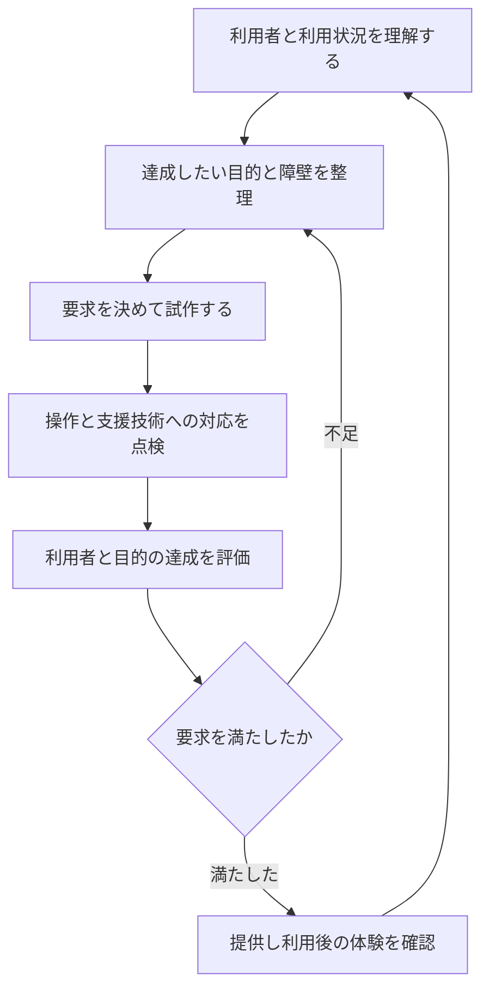

予約フォームのボタンを見やすくしたのに、予約を完了できない人が残る。そんなとき「UIを直したからUXも改善した」と言い切れるでしょうか。

UI・UX・ユーザビリティ・アクセシビリティ・ユニバーサルデザインは、見ている対象が違います。同じフォームを五つの観点から点検し、改善の次の一手を判断できるようにします。

## UIは接点、UXは利用前後を含む体験

<strong>UI（ユーザーインタフェース）</strong>は、利用者とシステムの接点です。画面の文字・ボタンだけでなく、キーボードや音声による入力、操作への反応も含めて考えます。

UX（ユーザーエクスペリエンス）は、利用を通じて生じる知覚や反応などの体験です。予約フォームの操作に加え、利用前の期待、完了通知、当日の受付までのつながりも評価の対象になります。

たとえばボタンは押しやすくても、送信後に予約できたか分からなければ不安が残ります。接点を改善することは体験を良くする手段の一つですが、それだけで体験全体の良さが保証されるわけではありません。

次に「操作できたか」と「障壁がなかったか」を区別します。

## ユーザビリティとアクセシビリティは重なるが、同じではない

ユーザビリティは、ある利用者が特定の利用状況で目的を有効に、効率よく、満足して達成できるかという観点です。「操作の回数が少ない」だけで評価せず、予約を正しく完了できたかも見ます。

アクセシビリティは、障害のある人も含め、情報や機能を利用できるようにする観点です。読み上げ、キーボード操作、文字拡大など、異なる利用方法で障壁が生じないかを考えます。[W3C WAI・アクセシビリティとユーザビリティ](https://www.w3.org/WAI/fundamentals/accessibility-usability-inclusion/)

たとえばマウスでは操作しやすいフォームでも、キーボードで日付を選べなければ利用できない人がいます。一部の利用者にとって使いやすい結果だけで、アクセシビリティも十分とは判断できません。

<strong>アクセシビリティは「後から直すこと」を意味しません。</strong>企画・設計時から考えられ、ユーザビリティの検証とも組み合わせて進めます。

## ユニバーサルデザインは、幅広い利用者を考える設計方針

ユニバーサルデザインは、できる限り多くの人が利用できる製品や環境を目指す考え方です。「一つの画面さえ作れば、すべての人のニーズを満たせる」という保証ではありません。

ノースカロライナ州立大学の7原則は、公平な利用、利用方法の柔軟さ、単純さ、情報の伝わりやすさ、誤操作への配慮、少ない身体的負担、適切な空間を整理しています。[NC State・ユニバーサルデザインの原則](https://design.ncsu.edu/research/center-for-universal-design/)

| 原則の要点 | 予約フォームで考える例 |
|---|---|
| 公平に使える | 利用方法の違いで必要な情報が欠けない |
| 使い方に柔軟性がある | マウスに加え、キーボードでも入力できる |
| 単純で分かりやすい | 必須項目と予約までの手順が分かる |
| 情報を認知できる | 入力エラーを色だけで伝えない |
| 間違いに寛容である | 送信前に内容を確認でき、修正もしやすい |
| 身体的な負担が少ない | 同じ情報の不要な再入力を減らす |
| 利用のための空間がある | 端末や姿勢を踏まえ、操作対象へ届きやすくする |

表は学習用の応用例です。7原則を満たすことと、Webの特定の規格に適合することは別に確認します。

では、設問や実際の問題をどの言葉へ結びつければよいでしょうか。

## 同じフォームの問題を5用語で見分ける

| 問われている条件 | 中心となる用語 | 具体的に見ること |
|---|---|---|
| ボタン・入力・画面の反応など、接点そのもの | UI | 押す対象、ラベル、反応の分かりやすさ |
| 予約前の期待から、利用後の印象まで | UX | 一連の体験で安心して目的を果たせたか |
| 特定の利用状況で正しく効率よく完了できるか | ユーザビリティ | 完了率、時間、誤操作、満足度 |
| 読み上げやキーボードなどで利用できない障壁があるか | アクセシビリティ | 情報取得と操作の障壁 |
| 幅広い人が使えるよう、設計の出発点から考える方針か | ユニバーサルデザイン | 多様な利用者・方法を設計へ含める |

一つの改善が複数の観点に効くこともあります。エラーに説明文を付ける施策なら、アクセシビリティの改善と、修正しやすさの改善の両方になり得ます。

試験問題では「誰でも」「最初から」という単語だけで機械的に選ばず、機能の障壁を問うのか、設計方針を問うのかを読み分けてください。

<!-- LEARNER_NOTE: 候補=アクセシビリティを後付け対応、ユニバーサルデザインを設計時の対応と区切っていた誤解 / 種類=think / 筆者の実体験で記入 -->

## 改善は、利用状況の把握と評価を繰り返す

人間中心設計（HCD）は、利用者と利用状況を理解し、要求を明らかにし、設計を評価しながら改善する進め方です。デジタル庁も利用者中心を原則とするサービスデザインの資料を公開しています。[デジタル庁・サービスデザイン](https://www.digital.go.jp/policies/servicedesign)



図は学習用に整理した流れです。五つの用語が、五つの工程として順番に登場するという意味ではありません。

Webでは、W3CのWCAGが知覚可能・操作可能・理解可能・堅牢の4原則に基づく達成基準を示します。たとえば色だけで情報を示さないこと、キーボードから操作できること、入力の目的をラベルで伝えることなどを確認します（2026年11月2日確認）。[W3C・WCAG 2.2](https://www.w3.org/TR/WCAG22/)

いくつかの項目を確認しただけで「規格に適合」とは言えません。対象範囲と適合レベルに応じた評価が必要で、実際の利用者による確認も組み合わせます。

## AIのレビューは、利用者の評価と区別する

```text
情報デザインの学習です。架空の予約フォームに次の問題があります。
・入力エラーは赤枠だけで示す
・日付はマウスでしか選べない
・送信後に完了通知がない
各問題をUI、UX、ユーザビリティ、アクセシビリティの観点で説明してください。
複数の観点に関わる場合は、その理由も書いてください。
改善案と、実際の利用者で確認すべきことを分け、
画面を見ていない状態で規格への適合を断定しないでください。
```

<!-- AI_EXAMPLE: 使うAI=Gemini / プロンプト=本文の予約フォーム3課題の分類と改善 / 見せたいこと=用語の重なりを説明し、推測の改善案と実利用者の検証を分ける回答 -->

AIが改善案を挙げても、それだけでは実際の利用者が予約を完了できた証拠にはなりません。案を点検項目に変えて、試作の評価に戻してください。

## まとめ

UIは接点、UXは利用前後も含む体験です。ユーザビリティは状況に応じた目的の達成、アクセシビリティは利用の障壁、ユニバーサルデザインは幅広い人を考える設計方針として区別できます。

[ITパスポート学習コース](/course/ip/)で、具体的な改善例を分類してみてください。試験全体へのつながりは[ITパスポート合格ロードマップ](/method/itp-hub/)で確認できます。
