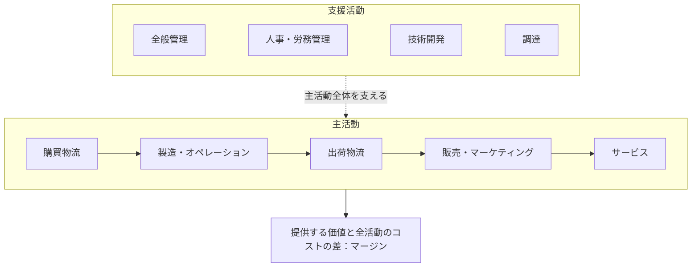

<!-- TARGET_KW: バリューチェーン 主活動 支援活動 違い -->
<!-- READER: S3-知的好奇心-学習中 / 検索｜調達と購買物流の区別で迷う社会人 -->
<!-- ANSWER: 物の種類や部署名ではなく活動の目的で分類し、コストと顧客価値・他工程への影響から改善を選ぶ。 -->
<!-- TAKEAWAY: 調達と購買物流の境界、9活動の関係、改善案の全体評価 -->

「原材料を仕入れる」は主活動で、「備品を買う」は支援活動。この覚え方だけでは、原材料の取引条件を交渉する活動の分類で迷います。

バリューチェーン分析では、買う物や担当部署よりも、何をする活動かが分かれ目です。架空の通販会社で主活動と支援活動を整理し、改善案を選ぶときの注意点まで確認します。

## バリューチェーン分析は、価値を生む活動を分けて見る

<strong>バリューチェーン（価値連鎖）</strong>は、企業が顧客に価値を届けるまでの活動を捉える枠組みです。ハーバード・ビジネス・スクールの解説では、企業を戦略上の活動に分け、高い価格や低いコストにつながる競争優位の源泉に注目します。[出典：HBS「The Value Chain」](https://www.isc.hbs.edu/strategy/business-strategy/Pages/the-value-chain.aspx)

単に作業の順番を描くのではなく、「どの活動が、どんな価値や費用に関係するか」を見ます。特定の部署だけを効率化しても、ほかの活動で費用や手間が増えれば、全体の改善とは限りません。

## 主活動と支援活動の全体図

代表的なモデルでは、主活動を五つ、支援活動を四つに分けます。主活動は顧客への提供に直接関わり、支援活動はその実行を支えます。[出典：HBS「Value Chain図」](https://www.isc.hbs.edu/strategy/business-strategy/Pages/the-value-chain.aspx)



矢印は関係を整理したもので、顧客の購入手続や実際の業務が常にこの順に進むという意味ではありません。

架空の通販会社で考えると、次のように対応します。

| 活動 | 目的 | 学習用の例 |
| --- | --- | --- |
| 購買物流 | 投入する物を受け入れ、保管・供給する | 入荷商品の検品と棚入れ |
| 製造・オペレーション | 提供する製品・サービスを作る | 注文に合わせた商品の加工やセット組み |
| 出荷物流 | 完成した物を顧客側へ届ける | 出荷の仕分けと配送 |
| 販売・マーケティング | 顧客に選ばれ、購入されるようにする | 商品説明や販売促進 |
| サービス | 購入後も価値を維持・向上する | 返品相談や修理対応 |
| 全般管理 | 企業全体を管理する | 財務・法務・経営管理 |
| 人事・労務管理 | 人を採用・育成・配置する | 検品担当者の研修 |
| 技術開発 | 製品や業務の技術を改善する | 検品方式の開発 |
| 調達 | 必要な資源を購入する条件を整える | 商品や設備の仕入先選定・価格交渉 |

分類例はモデルの理解を助けるための整理です。同じ部署が複数の活動を担当することもあります。

## 調達と購買物流は、買う物ではなく動作で区別する

調達を「備品などの間接材の購入だけ」と覚えるのは不十分です。HBSの解説でも、調達は仕入先の能力や効率を高める活動として取り上げられています。[出典：HBS「Redefining Productivity in the Value Chain」](https://www.isc.hbs.edu/creating-shared-value/csv-explained/three-levels-of-csv/Pages/redefining-productivity-in-the-value-chain.aspx)

この活動の見方に沿って、以下では原材料や設備の購入条件を整えることを調達、到着した原材料を受け入れ・保管することを購買物流として整理します。

境界で迷うときは、次の動作に注目します。

- 原材料でも設備でも、仕入先・価格・契約条件を選ぶ → 調達として整理する。
- 到着した原材料を検品し、倉庫で保管する → 購買物流として整理する。
- 製品を顧客に発送する → 出荷物流として整理する。
- その担当者を採用・教育する → 人事・労務管理として整理する。

例えば「仕入先と納入条件を交渉する担当者が、届いた部品を検品した」という文なら、前半と後半は別の活動です。部署名が同じでも、動作ごとに分けられます。

## コスト削減だけで改善案を決めない

次は効果を保証する実例ではなく、比較のための架空設定です。

| 改善候補 | その活動だけで見た効果 | ほかの活動で確認する条件 |
| --- | --- | --- |
| 安い仕入先に変える | 購入費を抑えられる | 不良や納期遅延で検品・返品対応が増えないか |
| 検品を減らす | 検品工数を減らせる | 出荷後の不良や顧客負担が増えないか |
| 問合せへの説明を整える | 回答の重複を減らせる | 顧客が自己解決できるか、誤解が増えないか |

判断は「費用が下がる」だけで止めず、顧客価値と他工程の費用を合わせて行います。数字がなければ、利益の最大化まで断定せず、測る項目を決める段階にとどめます。

## 生成AIには、分類と不足情報の指摘を頼む

AIに会社名だけを渡して「強みを特定して」と頼んでも、社内のコストや顧客評価は分かりません。架空例や公開できる情報で、活動の分類と根拠の不足を検討します。

```text
バリューチェーンの主活動と支援活動を理解したいです。
架空の通販会社で、仕入先との価格交渉、入荷品の検品、
検品担当者の研修を、すべて購買物流だと私は分類しました。
分類の境界を私に問い返し、動作の違いを説明させてください。
続けて、仕入先を変更するときに他の活動で測るべき項目を尋ねてください。
利益額や実在企業の成果を作らないでください。
```

<!-- AI_EXAMPLE: 使うAI=ChatGPT / プロンプト=本文「分類と不足情報の指摘」 / 見せたいこと=調達・購買物流・人事の混同と、改善判断の不足情報を検討する対話。実行結果は筆者が用意 -->

---

## まとめ：動作を分け、活動のつながりで判断する

主活動と支援活動は、部署名や物の種類より、活動の目的で分類します。特に調達は購入条件を整える活動、購買物流は受入れ・保管に関わる活動という違いを押さえましょう。

経営戦略を続けて学ぶなら[ITパスポート20時間コース](/course/ip/)、試験全体の入口は[合格ロードマップ](/method/itp-hub/)です。

本記事は受験・企業分析の体験談ではなく、原典の枠組みと学習用の架空例をもとにした解説です。
