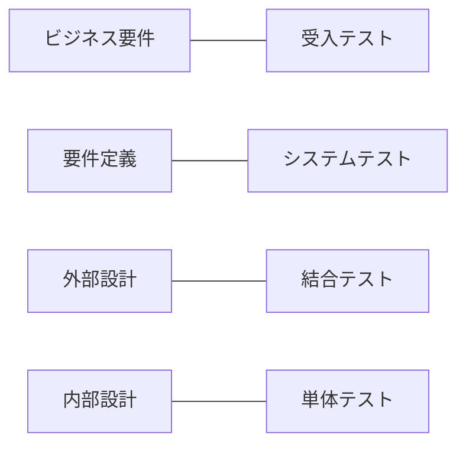

ホワイトボックスはコードの中身、ブラックボックスは入力と出力を見る手法です。単体テストは主に前者、システム・受入テストは主に後者で確かめます。

テストには手法と工程の2つの軸があります。この記事では、「中身を見るか」と「どの設計に対応するか」を分け、V字モデルでのつながりまで整理します。

## 全体像

| 軸 | 用語 | ひとことで |
| --- | --- | --- |
| 手法 | ホワイトボックステスト | プログラムの内部構造（コード）を見て確かめる |
| 手法 | ブラックボックステスト | 中身は見ず、入力と出力だけを確かめる |
| 工程 | V字モデル | 設計工程と、それに対応するテスト工程を結んだ図 |

### 受ける試験で、どこまで覚えるか

2026年11月時点のシラバスの用語例で分けた目安です。用語例にない語も出題対象外とは限りません。

| 試験 | 学習の目安 |
| --- | --- |
| ITパスポート（現行Ver.6.5） | ホワイトボックス・ブラックボックス・回帰テスト（用語例） |
| ITパスポート（2027年度の案Ver.0.1） | 3語は未掲載。案の改訂を確認し、手法と工程を区別 |
| 基本情報（Ver.9.2） | 上記と命令網羅・判定条件網羅・同値分析法・限界値分析法（用語例） |

出典：[IPA現行シラバス](https://www.ipa.go.jp/shiken/syllabus/gaiyou.html)・[新試験案](https://www.ipa.go.jp/shiken/syllabus/henkou/2026/20260630.html)。基本情報の4語は、現行のITパスポートの用語例にありません。

## ホワイトボックスとブラックボックス

おもちゃの修理にたとえると、<strong>ホワイトボックス</strong>は分解して、歯車の噛み合わせや配線を確かめること、<strong>ブラックボックス</strong>は外からスイッチを押して、音が鳴るか、光るかを確かめることです。

| 項目 | ホワイトボックス（構造テスト） | ブラックボックス（機能テスト） |
| --- | --- | --- |
| 見るもの | 内部のロジック（コードの行や条件分岐） | 入力と出力（結果） |
| 主に使う工程 | 単体テスト | システムテスト、運用（受入）テスト |
| 重視する指標 | 網羅率（カバレッジ） | 仕様どおりに動くか、異常な入力でエラーが出るか |
| 見つけやすいバグ | 実行されないコード、特定の条件でだけ起こる論理ミス | 機能の作り忘れ、使い勝手の悪さ |

どちらか一方だけでは足りません。ブラックボックスだけでは、内部で特定の条件のときだけ起こる問題を見逃すことがあります。逆に、ホワイトボックスだけでは、機能そのものの作り忘れに気づけません。

### ホワイトボックスの網羅基準

「どこまでテストしたか」を表す指標です。

| 基準 | 内容 |
| --- | --- |
| 命令網羅 | すべての命令（行）を、少なくとも1回実行する |
| 判定条件網羅 | すべての分岐（真と偽の両方）を、少なくとも1回実行する |

判定条件網羅のほうが、命令網羅より厳しい（細かい）基準です。分岐の真偽を両方通したかで区別します。

```text
# 架空：20歳以上かつ会員なら割引
if 年齢 >= 20 and 会員:
    割引する()
```

命令網羅は「20歳・会員」1件。判定条件網羅は「19歳・会員」も加え、割引の有無を通す2件です。

### ブラックボックスの技法

| 技法 | 内容 |
| --- | --- |
| 同値分割 | 入力値を「同じ扱いになるグループ」に分け、各グループの代表値を1つずつテストする |
| 境界値分析（限界値分析） | グループの境目の値をテストする。たとえば「0〜100点の整数で60点以上なら合格」なら59点と60点（有効な範囲の端として−1・0・100・101も）。バグは境界で起こりやすい |

## V字モデル｜設計とテストの対応

テストを一度にまとめて行うと、エラーが出たときに、プログラムの書き間違いなのか、設計のミスなのか、要望の取り違えなのかが分かりません。そこで、<strong>設計工程とテスト工程を段階的に対応させる</strong>のがV字モデルです。左側に設計工程、右側にテスト工程を並べ、同じ高さのものを結びます。

結合テスト（シラバスでは統合テスト）を含む対応です。

| テスト工程 | 対応する設計 | 確かめること |
| --- | --- | --- |
| 単体テスト | 内部設計（詳細設計） | 最小単位（モジュールや関数）が設計どおりに動くか |
| 結合テスト | 外部設計（基本設計） | 複数のモジュールを組み合わせたとき、データが正しく受け渡されるか |
| システムテスト | 要件定義 | システム全体として、必要な機能が備わっているか。性能やセキュリティも、本番に近い環境で確かめる |
| 運用テスト（受入テスト） | ビジネス要件（利用者の要望） | 実際に使う利用者が「これで仕事ができるか」を確かめる最終関門 |

試験では、<strong>単体テストと内部設計、結合テストと外部設計、システムテストと要件定義</strong>の3つのペアを区別して覚えます。

段階を分けると、バグの出どころを絞り込めます。単体テストで出れば、プログラミングのミス。結合テストで出れば、モジュール間のつなぎ目のミス。システムテストで「機能が足りない」とわかれば、要件定義のミスです。



### 回帰テスト

<strong>回帰テスト（レグレッションテスト）</strong>は、修正したことで、これまで動いていた別の部分に不具合が出ていないかを確かめる再テストです。

## 手法と工程のつなぎ方

2つの軸は、次のように結びつけて覚えると、組み合わせ問題で迷いません。

- 単体テスト（内部設計に対応）では、中のロジックを見るので、主に<strong>ホワイトボックス</strong>
- システムテストや運用テスト（要件に対応）では、機能を外から確かめるので、主に<strong>ブラックボックス</strong>
- 開発者が行うのは単体・結合のテスト、利用者が行うのは受入テスト

## 生成AIでテストケースを作る

テストデータを手で考えるのは大変です。AIを「テストエンジニア」として使うと、テストの視点を学べます。

```text
入力フォーム「年齢」（0〜120歳の整数）があります。
0歳未満や数値以外はエラーという仕様です。
このブラックボックステストについて、同値分割と境界値分析に基づいた
テストデータを、最小限かつ漏れなくリストアップしてください。
```

答え合わせ：境界値は−1・0・120・121。同値の代表は60（有効）・−5と文字列（無効）。ただし「120超はエラー」と明記がないため、121の扱いは仕様で確かめます。

```text
要件定義「ユーザーがログインし、マイページを表示する」に対する
システムテストの項目を10個、境界値や異常系も含めて、表形式で書き出してください。
```

AIの出した項目を見て、正常・異常・限界値のうち、どの視点が足りないかを自分で確かめてみてください。

---

## まとめ

- ホワイトボックスは中身（構造）を見る手法で、単体テストで主に使う。命令網羅より判定条件網羅のほうが厳しい
- ブラックボックスは入力と出力を見る手法で、システムテストや受入テストで主に使う。同値分割と境界値分析で入力の選び方を考える
- V字モデルは、設計工程とテスト工程の対応図。単体↔内部設計、結合↔外部設計、システム↔要件定義
- 回帰テストは、修正で他の部分が壊れていないかの再確認

次は、開発の進め方を扱う[アジャイル・スクラム・ウォーターフォールの記事](/theory/agile-scrum-basics/)を読むと、テストが開発全体のどこに位置するかがつながります。

試験全体の学習順は、[基本情報技術者試験 合格ロードマップ](/method/fe-hub/)と[ITパスポートの学習ガイド](/method/itp-hub/)で確認できます。
