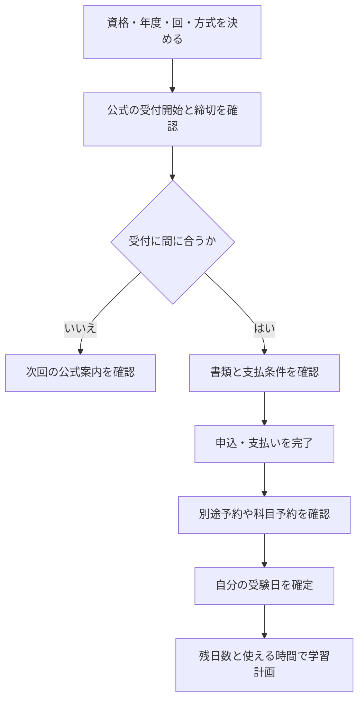

<!-- TARGET_KW: 資格試験 申込から本番まで 期間 -->
<!-- READER: S3-義務-検討前 / 検索 ｜ 受けたい資格が決まり、申込と学習の順を考える社会人 -->
<!-- ANSWER: 固定日試験は受付期限、随時CBTは予約可能日と休止を確認し、自分の受験日で逆算する -->
<!-- TAKEAWAY: 申込開始からの日数と残日数の違い、試験方式別の確認先、申込と予約の区別 -->

受けたい資格は決まったけれど、申し込んでから勉強を始めても間に合うのか。日程を比べるときは、「受付開始からの期間」と「今日から自分の受験日までの期間」を分ける必要があります。

同じ資格でも、受験方式や回によって準備期間は変わります。この記事では、2026年度の公式日程の比較と、今から確認する順番を整理します。

## 日数を比べる前に、三つの日付を分ける

| 日付 | 判断すること |
| --- | --- |
| 申込開始日 | その回の受付がいつ開くか |
| 申込締切日 | 申請や支払いをいつまでに済ませるか |
| 自分の受験日 | 実際に学習へ使える残り時間がどれだけあるか |

受付開始から本番まで半年あっても、受付窓口が半年開いているわけではありません。また、実施期間の最終日を選べるとは限らないため、予約した日を基準にします。

以下は2026年11月2日時点の公式情報です。日数は開始日を0日として、試験日との差を計算しています。試験に必要な勉強時間を表す数字ではありません。

## 固定日・期間指定型の早見表

代表的な回について、受付開始から本番までを長い順に並べました。資格の全回を調べた「年間最大値」のランキングではなく、比較条件をそろえた例です。

| 資格・対象の回 | 申込期間 | 比較に使った本番 | 開始からの日数 | 11月2日時点の受付 | 一次情報 |
| --- | --- | --- | --- | --- | --- |
| 1級土木施工管理・新規の第二次検定 | 2026/3/23〜4/6 | 2026/10/4 | 195日 | 終了・試験も実施済み | [全国建設研修センター](https://www.jctc.jp/exam/doboku-1/) |
| 電験三種・下期筆記 | 2026/11/9〜11/26 | 2027/3/21 | 132日 | 開始前 | [電気技術者試験センター・日程PDF](https://www.shiken.or.jp/chief/upload/R08denkennittei2.pdf) |
| 電験三種・下期CBT | 2026/11/9〜11/26 | 2027/2/4〜2/28の最終日 | 111日 | 開始前 | [同・日程PDF](https://www.shiken.or.jp/chief/upload/R08denkennittei2.pdf) |
| 宅建・インターネット申込 | 2026/7/1〜7/31 | 2026/10/18 | 109日 | 終了・試験も実施済み | [不動産適正取引推進機構](https://www.retio.or.jp/exam/schedule/) |
| TOEIC L&R公開テスト・11/15実施 | 2026/8/17〜10/5 | 2026/11/15 | 90日 | 終了 | [IIBC・年間日程](https://www.iibc-global.org/toeic/test/lr/guide01/schedule.html) |
| 応用情報・2026年度前期 | 2026/10/6〜11/7 | 科目B 2026/11/24〜12/6の最終日 | 61日 | 受付期間内 | [IPA・2026年度日程](https://www.ipa.go.jp/shiken/2026/ap_koudo_sc_kikan.html) |
| PM・DB・ES・AU・SC・2026年度後期 | 2027/1/27〜2/27 | 科目B群 2027/3/16〜3/28の最終日 | 60日 | 開始前 | [同・2026年度日程](https://www.ipa.go.jp/shiken/2026/ap_koudo_sc_kikan.html) |
| G検定・2026年第6回個人申込 | 2026/9/11〜10/29 | 2026/11/6・11/7の後の日 | 57日 | 終了 | [JDLA・第6回案内](https://www.jdla.org/news/20260911001/) |
| ST・SA・NW・SM・SC・2026年度前期 | 2026/10/6〜10/24 | 科目B群 2026/11/11〜11/23の最終日 | 48日 | 終了 | [IPA・2026年度日程](https://www.ipa.go.jp/shiken/2026/ap_koudo_sc_kikan.html) |
| 応用情報・2026年度後期 | 2027/1/27〜2/16 | 科目B 2027/3/3〜3/15の最終日 | 47日 | 開始前 | [同・2026年度日程](https://www.ipa.go.jp/shiken/2026/ap_koudo_sc_kikan.html) |

土木施工管理は、ここでは新規申込の掲載日程を使っています。受検資格や新規・再受検の別で案内を確認してください。宅建の郵送受付は2026年7月15日までで、表のインターネット受付と締切が違います。[土木の申込区分](https://www.jctc.jp/exam/doboku-1/)、[宅建の郵送・ネット受付](https://www.retio.or.jp/exam/schedule/)

2027年1〜3月のIPA試験は、この表では2026年度後期です。「2027年に受ける」ことと「2027年度の新制度」を同じ意味にしないでください。

## 今から使うなら、開始日からの期間を残日数に置き換える

2026年11月2日から年内の受験を考える場合、次のように読み替えます。空席や申込条件を満たすことが前提です。

| 条件 | 次に確認すること |
| --- | --- |
| 申込が終わった回をまだ申し込んでいない | 本番が未来でもその回の学習計画を組まず、次回の公式案内を確認する |
| 受付期間内だが実施期間が始まっている | 実際に選べる科目・会場・日を予約画面で確認する |
| これから受付が始まる | 申請書類・支払期限・別途予約の有無を開始前に確認する |
| 既に予約済み | 実施期間の最終日ではなく、予約した受験日から逆算する |

たとえば応用情報前期は、開始日から科目Bの最終日まで61日ありますが、11月2日から12月6日までは34日です。さらに科目Aは10月28日〜11月10日、科目Bは11月24日〜12月6日で、申込時に科目A群・B群を同時に予約する方式です。[IPA・実施期間と予約上の注意](https://www.ipa.go.jp/shiken/2026/ap_koudo_sc_kikan.html)

TOEICは回ごとに受付が別です。11月15日実施回は受付終了ですが、12月19日実施回は10月6日〜11月11日15時、2027年1月10日実施回は10月27日〜11月26日15時の受付です。希望の受験地も含め、対象回の案内を確認します。[IIBC・年間日程](https://www.iibc-global.org/toeic/test/lr/guide01/schedule.html)

## 随時CBTは、予約可能範囲と休止日を見る

随時型では、共通の「受付開始から本番まで」を一つの数字にしにくいため、固定日の表とは分けます。下表も2026年11月2日時点の情報です。

| 試験 | 日程の読み方 | 一次情報 |
| --- | --- | --- |
| ITパスポート | 9/28以降の新規申込は、12/27までの開催日から選ぶ | [IPA・休止と申込範囲](https://www.ipa.go.jp/shiken/2026/cbt-202605-jisshi.html) |
| SG・基本情報 | 9/1以降の新規申込は、12/27までの開催日から選ぶ | [同・休止と申込範囲](https://www.ipa.go.jp/shiken/2026/cbt-202605-jisshi.html) |
| FP2級・3級（日本FP協会） | 受検日の月を含む4か月前の月初から3日前まで予約可能。休止期間と空席を確認する | [日本FP協会・試験要綱PDF](https://www.jafp.or.jp/exam/app/howto/files/outline.pdf) |

ITパスポート・SG・基本情報は、2026年12月28日以降の休止予定が案内されています。会場によっては12月27日より前に休止し、再開時期は上記案内では決まり次第のお知らせです。[IPA・休止時期](https://www.ipa.go.jp/shiken/2026/cbt-202605-jisshi.html)

11月2日から12月27日までは55日ですが、これは最後の日まで予約できた場合の差です。全員に55日の準備期間があるという意味ではありません。

FPの「受検月を含む4か月前」は、たとえば12月受検なら9月1日からです。「120日前から」と日数で置き換えず、月単位の条件で読みます。[日本FP協会・予約条件](https://www.jafp.or.jp/exam/app/howto/files/outline.pdf)

## 全国の試験日だけでは申込開始日が決まらないものもある

日商簿記の統一試験は、第174回が2026年11月15日、第175回が2027年2月28日です。ただし、受付期間・受付場所は各地の商工会議所等で異なると公式に案内されています。[日本商工会議所・2026年度カレンダー](https://www.kentei.ne.jp/calendar_2026)

そのため、特定地域の申込開始日を全国共通として日数計算しません。受験する地域・級・方式を決めてから、現地の受付を確認します。

危険物取扱者などの地域別試験も、希望する支部の回を選ぶ必要があります。東京の試験案内では、日程の確認先に加え、会場の関係で受付期間中にも終了する場合があるとされています。[消防試験研究センター・東京試験案内](https://www.shoubo-shiken.or.jp/branch/13center/content/kikenbutsuannai.pdf)

日程表に期限が書かれていても、希望の回や会場を確保できたかを別に確かめましょう。

## 申込と会場予約を別々に確認する

電験三種の2026年度下期は、申込が11月9日10時〜11月26日17時、CBT会場予約は12月7日〜2027年1月7日です。CBT本番は2027年2月4日〜2月28日で、申込を済ませた後に予約の工程が残ります。[電気技術者試験センター・下期日程](https://www.shiken.or.jp/chief/upload/R08denkennittei2.pdf)

カレンダーには、本番だけでなく「申込」「支払い」「別途予約」の期限を分けて入れます。必要な確認を順にすると、次の流れです。

受験日までに何を学ぶかは、[ITパスポートの合格ロードマップ](/method/itp-hub/)や[宅建の合格ロードマップ](/method/takken-hub/)で範囲と手順を確認できます。

筆者は、この表にある資格すべてを受験したわけではありません。未受験の資格の体験談としてではなく、公式日程を同じ条件で比較した資料として掲載しています。

---

## まとめ

資格試験の申込から本番までの期間は、方式と対象回をそろえて比べます。受付が終わった回は次回へ、随時CBTは空席と休止期間へ、予約済みなら自分の受験日へと、見る情報を変えてください。

最初に公式案内で「締切」と「別途予約」を確認し、その後に残り時間で学習計画を立てましょう。2027年度の日程を、2026年度の実績から推測して予定に入れないことも大切です。
