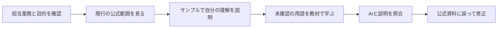

ITパスポートに合格して、次は金融IT検定を取るべきか。名前だけでは、何を追加で学ぶ資格なのか判断しにくいかもしれません。

分かれ目は、金融のシステムについて、業務側とIT側で話す必要があるかです。金融に関心があることと、今の自分に受験が必要なことは分けて考えられます。

この記事では初級を対象に、確認できた試験制度と、難易度を自分で確かめる方法を整理します。読み終えたら、受験する・先にIT基礎を補う・今は見送る、の判断ができます。

筆者は金融IT検定を未受験です。合格に必要だった時間や、試験を受けた感想は扱いません。

## 金融IT検定とは何か

金融IT検定初級は、金融IT協会（FITA）の検定です。金融機関の職員や金融を担当するベンダー職員など、金融ITに携わる人の共通言語を目指す試験として案内されています。出典: [主催団体の初級案内](https://fita.or.jp/digitalhr/certificate)、[試験配信を行うCBT-Solutionsの案内](https://cbt-s.com/examinee/examination/fita.html)。

国家試験のITパスポートと同じ資格ではなく、金融業務とシステムをつなぐ知識に目的を絞って検討します。受験前には勤務先での評価や取得指示も確認してください。

以下は2026年10月31日に確認した初級の情報です。料金や予約条件は申込時点の案内を優先します。

| 項目 | 初級の案内 |
| --- | --- |
| 受験資格 | どなたでも受験可能 |
| 出題形式 | CBT・択一選択式60問、60分 |
| 受験料 | 一般8,800円、会員5,280円（いずれも消費税10%込み） |
| 会員価格の条件 | 受験チケットの事前購入が必要 |
| 不合格後の再受験 | 前回受験日から30日を経過してから |

出典: [CBT-Solutions・金融IT検定の試験概要と料金](https://cbt-s.com/examinee/examination/fita.html)。会員に該当するか分からない場合は、通常価格で判断する前に勤務先や主催団体へ確認します。

中級については、主催団体が2026年10月の第1回実施予定を発表しています。初級の料金・形式をそのまま中級に当てはめないでください。出典: [金融IT協会による中級開発の発表](https://prtimes.jp/main/html/rd/p/000000007.000135952.html)。実施済みかどうかや次回日程は、別に最新案内を確認する必要があります。

## ITパスポートとどこが重複するのか

ITパスポートは、経営・管理・技術を幅広く扱う国家試験です。一方、金融IT検定初級の案内は金融分野のシステム知識に焦点を置いています。出典: [ITパスポート試験｜IPA](https://www.ipa.go.jp/shiken/kubun/ip.html)、[金融IT検定初級の対象者](https://cbt-s.com/examinee/examination/fita.html)。

この目的の違いから、「ITパスポートに合格したから半分は学習済み」といった割合は出せません。同じ用語があっても、金融の場面で説明できるかは別に確認します。

たとえばAPIという用語を知っていても、利用者の依頼がどのシステムへ渡り、どこで認証・記録が必要になるかを説明しようとすると、知識の不足が見えます。これは学習用の考え方の例で、特定の銀行システムの構成や出題内容を示すものではありません。

| 今持っている知識 | 次に確認すること | 不足があった場合 |
| --- | --- | --- |
| IT用語の意味を知っている | 金融の業務の中で何のために使うか | 公式教材の該当項目を読む |
| 金融の業務を知っている | システム間の関係を説明できるか | IT基礎と用語を対応づける |
| どちらも初めて | サンプル問題の語句を理解できるか | 受験日を決める前に基礎学習を試す |

IT全般の基礎が不安なら、[ITパスポートの合格ロードマップ](/method/itp-hub/)から補う選択肢もあります。必ずITパスポートを先に取得しなければならない、という受験要件ではありません。

## 難易度は合格体験記の時間より、説明できる範囲で確かめる

他人の「数時間で合格」という記録には、その人の金融・ITの前提知識が含まれます。未経験者が同じ時間で合格できる根拠にはならないため、この記事では標準時間として使いません。

[主催団体の試験概要・参考資料](https://fita.or.jp/digitalhr/certificate)から、現行の範囲と学習資料を確認します。サンプル問題を使う場合は、正解の選択肢だけでなく「なぜ他の選択肢が違うか」まで自分で説明してください。

| 確認した状態 | 判断 | 次の行動 |
| --- | --- | --- |
| 正解し、理由も説明できる | その項目は復習中心にできる | 別分野でも同様に確認 |
| 正解したが、理由は説明できない | 学習済みと数えない | 用語の定義と用途に戻る |
| 不正解で、用語自体が初見 | 基礎の補強が必要 | 公式教材の該当箇所を読む |
| 解説を読んでも業務像が浮かばない | 金融の文脈を補う | 架空の業務場面に置き換えて説明する |

少数のサンプルで合格確率は出せません。正答率だけで予約を決めず、範囲全体に未確認の項目が残っていないかを見ます。

## 金融IT検定を選ぶ人・今は見送る人

| 条件 | 選び方 | 確認先 |
| --- | --- | --- |
| 金融機関や金融向けIT案件で共通用語を学びたい | 初級を候補にする | 現行範囲と担当業務の重なり |
| 勤務先が取得を指定している | 指定級を確認して進める | 社内の期限・費用補助・評価規程 |
| 金融との接点がなく、IT全般を学びたい | IT基礎を優先する | IPA等の範囲と自分の目的 |
| 転職で有利という理由だけで迷っている | 求人の指定や評価が確認できるまで保留 | 応募先の募集要項 |

資格取得だけで金融ITの実務能力や採用評価が保証されるわけではありません。何を説明できるようにしたいかを一つ決めると、受験費用と学習時間をかける目的が明確になります。

## AIは、金融の場面と用語をつなぐ説明相手にする

AIに合否の予測や出題範囲の推測を頼むより、確認した教材の内容と自分の理解を照合させます。実在の顧客情報や社内資料を入力せず、学習用の架空例で試してください。

```text
金融IT検定初級の学習で、次の用語が理解できていません。
【用語】（現行の公式範囲から選ぶ）
【教材で確認した定義】（自分の言葉で要約）
【自分の理解】（何のために使うと考えたか）

1. 定義と私の理解の食い違いを1点ずつ指摘してください。
2. 架空の金融業務の場面を1つ使い、その用語が必要な理由を説明してください。
3. 例え話が実際の制度・システムと一致しない部分を明示してください。
4. 私が説明し返すので、教材で確かめるべき点だけを質問してください。
出題割合、合格基準、社内システムの仕様は推測しないでください。
```

### Claudeで試した結果：例え話だけを頼むとどうなるか

上のプロンプトの前に、教材の定義を渡さず、例え話だけを頼む聞き方をClaude（Sonnet 5.5、有料プラン）で試しました（2026年10月）。

```text
金融IT検定に出てくる「全銀ネット」「CAFIS」「勘定系システム」について、
ITの一般的な仕組みに例えて説明してください。
専門用語を1つずつ、身近な例え話に変換してください。
```

回答の例えは、次のとおりでした（要約）。

| 用語 | Claudeの例え | 役割の説明 |
| --- | --- | --- |
| 全銀ネット | 全国の銀行をつなぐ中継センター（ハブ＆スポーク型のネットワーク）と精算所 | 銀行どうしの振込の通知と、銀行間の差額の精算 |
| CAFIS | 店のレジとカード会社をつなぐ、決済専用のAPIゲートウェイ | 店・ATMとカード会社・銀行の間のオンライン決済の中継 |
| 勘定系システム | 会社の基幹システム（ERP）の中核データベース | 口座残高・入出金・利息など、銀行内のお金の記録の管理 |

最後に、他行あての振込を「自分の銀行の勘定系で残高を減らす → 全銀ネットで相手の銀行に通知 → 相手の銀行の勘定系で残高を増やす」の流れでまとめ、「どこの間をつなぐかで区別すると覚えやすい」と締めていました。

「銀行どうし」「店と決済先」「銀行の中」という3つの役割の分け方は、大筋で合っています。用語の位置関係をつかむ入り口としては十分です。

ただし、例えと実物がずれる所もあります。CAFISは一般的な意味の「APIゲートウェイ」ではなく、カード決済のための専用ネットワークです。勘定系も、ERPと同じ作りのシステムではありません。

例えだけを頼むと、こうしたずれが説明の中に混ざったまま残ります。上のプロンプトで「例え話が実際の制度・システムと一致しない部分を明示して」と頼んでいるのは、このためです。

<!-- LEARNER_NOTE: 候補=金融用語の例え話で理解が進んだ点と教材に戻って修正した点 / 種類=think / 筆者のAI使用の実体験で記入 -->

返答の採用条件は、定義が教材と合い、架空例と実在の制度を区別できることです。説明の根拠が示せなければ、教材の該当項目へ戻ります。



---

## まとめ

金融IT検定初級は、金融とITの間で共通用語を持ちたい人の候補です。ITパスポートの次だから自動的に選ぶのではなく、担当業務との接点と、公式資料で確認した不足を基準にしてください。

最初の一歩は、現行の公式範囲を見て、仕事や関心に結びつく項目を一つ選ぶことです。その項目を自分の言葉で説明してから、受験するか、基礎学習を先にするかを決めましょう。
