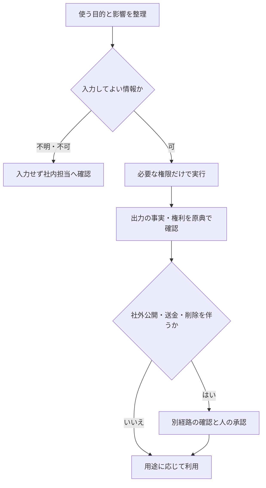

---

生成AIのリスクは、「情報が漏れる」「間違える」といった一言で語られがちです。

ただ、実際に起きた事例を並べると、<strong>原因は5つの系統に分けられ、防ぎ方も系統ごとに違います</strong>。

この記事では、判決文・公的機関の文書・当事者の発表で確かめられる7件の事例・注意喚起を、5つの系統に当てはめて整理します。

読み終えるころには、自分の職場で起こりうるリスクを系統ごとに挙げ、どこから対策すべきかを説明できるようになります。

なお、生成AIパスポートは<strong>2027年2月試験から新シラバス</strong>になり、リスクの項目が大きく増えました。最後に、新シラバスとの対応表も付けています。[GUGAの改訂発表](https://guga.or.jp/2026-10-01-1100-2)

## リスクは「出力・入力・権利・悪用・自律動作」の5系統

先に、全体像を表で示します。

| 系統 | 何が起きるか | 本記事の事例 |
| --- | --- | --- |
| 出力 | AIの答えが誤っている、偏っている | 偽の判例の提出、チャットボットの誤案内 |
| 入力 | 入れた情報が外に出る、法令に触れる | 個人情報の入力への注意喚起、当局の制裁とその後 |
| 権利 | 他人の権利を侵す、自分の権利が問題になる | 文化庁の判断枠組み（事故例ではない） |
| 悪用 | 他人にAIで騙される | ディープフェイクの送金詐欺 |
| 自律動作 | AIが権限の範囲で想定外の動きをする | 本番データベースの削除、開発ツールへの混入 |

裁判・当局の判断、企業・当事者の公表、利用上の注意喚起を分けて読みます。以下の5系統は本記事の整理で、公式シラバスの分類名ではありません。権利の系統には、事故例に代えて文化庁の判断枠組みを置きます。

まず、最も身近な「出力」の系統から見ていきます。

## 出力の系統：AIの答えは、使う人が確かめる

### 存在しない判例を、裁判所へ出した弁護士

米国で、弁護士がChatGPTで調べた判例を、確認しないまま裁判所へ提出しました。判例も、引用も、存在しないものでした。

ニューヨーク南部地区連邦地裁は、<strong>2023年6月22日</strong>に制裁を命じ、弁護士2名と所属事務所に5,000ドルの罰金を科しました。依頼人と、偽の意見の作成者として名前を挙げられた各判事への通知も命じています。[制裁命令の原文](https://storage.courtlistener.com/recap/gov.uscourts.nysd.575368/gov.uscourts.nysd.575368.54.0_3.pdf)

判決文には、「信頼できるAIツールの補助を受けることに、本質的に不適切なところはない」と書かれています。そのうえで、弁護士には書面の正確性を確保する役割があるとして、偽の判例を出したことに加え、裁判所が存在を疑った後もそれを維持し続けたことを重く見ました。

つまり、問題はAIを使ったことではなく、<strong>確かめずに出し、指摘されても訂正しなかったこと</strong>です。

ここで、「間違うなら、最初からAIに作らせなければいいのでは？」という疑問が浮かびます。

この事例から学習上の教訓として取り出せるのは、出力を原典と照合し、誤りを訂正する工程が必要だということです。確認すればあらゆる責任を免れるという意味ではありません。

AIは、答えの正しさを保証する道具ではありません。下書きや調べものの出発点を、速く作ってくれる便利なツールです。

論点は、使うかどうかではなく、<strong>確認を前提に使えば、信頼できる道具になる</strong>かどうかです。

検索結果も、中身を確かめずに引用すれば同じ失敗をします。AIの出力も、確かめる人が使うから、道具として役に立ちます。

### チャットボットの誤案内に、企業が責任を負った

カナダの航空会社Air Canadaでは、Webサイトのチャットボットが、忌引運賃を「後から申請できる」と案内しました。実際の規定は、旅行後の遡及申請を認めていませんでした。

ブリティッシュコロンビア州の審判所は、2024年2月14日の決定で、航空会社に過失による不実表示の責任を認めました。賠償・利息・手続費用を合わせて812.02カナダドルの支払いを命じています。航空会社がチャットボットを別の主体のように扱った主張も退けました。[決定原文の第27段落・第44段落](https://decisions.civilresolutionbc.ca/crt/crtd/en/525448/1/document.do)

自社のサイトに置いたAIの回答は、<strong>企業自身の発言として扱われうる</strong>ということです。

なぜチャットボットが誤った案内をしたのかは、確認できた資料では分かりません。正しい規定が入力されていなかった可能性も、参照した情報に同じ誤りがあった可能性もあります。

どちらの場合でも、航空会社は、公開する前に、チャットボットが規定どおりに答えるかを検証しておく必要がありました。AIの答えを確かめずに信じてしまう「過信」が、招いた面があります。

とはいえ、こうした事故が起きて初めて、運用の穴が見つかる面もあります。だからこそ、公開後も回答を点検し続ける体制が要ります。

### 出力の系統の防ぎ方

ここまでの2つの事例で出た疑問は、「AIを使わなければいいのでは」と「そもそも、なぜAIは間違えるのか」でした。次に、順に答えます。

なぜAIは間違えるのか。生成AIは、学習したデータの傾向から、「もっともありそうな続き」を確率で選んで文章を作るしくみです。そのため、同じ質問をしても、毎回まったく同じ答えになるとは限りません。

また、質問の言い方や前提が変われば、AIが「この人が知りたいのは、こういうことだろう」と推測する方向も変わります。入力と学習が十分でも、使う人の質問次第で別の答えが出て、事例のような問題につながる可能性は捨てきれません。

つまり、AIの出力には、学習データの偏りと、質問の仕方による偏りが入り込みます。AIから必要な情報を引き出すには、<strong>バイアスがあることを理解して使う</strong>ことが前提になります。

この間違いの受け止め方には、二つの立場があります。「人間だって間違うのだから、確認すれば足りる」と考える人と、「機械なのだから、間違えないのが当然だ」と考える人です。

どちらを期待するかで、確認の手間のかけ方が変わります。AIを「便利だが、間違うこともある道具」と位置づけると、確認を前提にした使い方になります。

では、確認はどの程度すればよいのでしょうか。出力の誤りは、AIの側では完全には防げません。使う側が、<strong>用途と影響の大きさに応じて、確認の深さを変える</strong>ことが現実的です。

新シラバスでは、これを「検証レベル」と呼びます。社内の連絡メモなら軽く、社外に出す資料や、法律・数字を含む文書なら、一次情報で事実確認をしてから使います。

次は、AIに「入れるもの」の系統です。

## 入力の系統：入れた情報は、手元に戻らないことがある

### 個人情報を入れるときの、日本の公的な注意

日本では、個人情報保護委員会が<strong>2023年6月2日</strong>に、「生成AIサービスの利用に関する注意喚起等について」を出しました。

事業者向けの要点は、2つです。

- 個人情報を含むプロンプトを入れるときは、利用目的の達成に必要な範囲内かを確認する
- あらかじめ本人の同意なく個人データを入れ、その個人データが応答の出力以外の目的で取り扱われる場合は、個人情報保護法に違反する可能性があるため、提供事業者が機械学習に使わないことなどを確認する

一般の利用者へも、入力した個人情報が機械学習に使われうること、応答に不正確な個人情報が含まれうること、利用規約を確認することを求めています。[個人情報保護委員会の注意喚起](https://www.ppc.go.jp/news/press/2023/230602kouhou/)

これは実際の漏えい事件の紹介ではなく、利用時の注意喚起です。会社が承認していないAIを業務で使う「シャドーAI」の対策にもつながります。

「学習に使わない」と規約に定めたプランでも、個人情報は入れないのが基本です。

法人向けのプラン（Businessなど）には、入力した情報を基本的に学習に使わないと、規約で定めているものがあります。ただ、これを過信して、社員の氏名やIDなどの個人情報をそのまま入れるのは避けたい行為です。

学習されなくても、入力した情報の流出経路は残るからです。サービス側への不正アクセスや不具合のほか、自分のPCに残る履歴や共有アカウントからも、情報は漏れえます。

だから、AIが「学習しません」と言っていても、社員の実名や住所などは、<strong>ぼかすか、架空のものにしておく</strong>のが、AIリテラシーの基本です。

具体的な工夫を一つ挙げます。たとえば、Excelの勤怠表をAIに整理させたり、統計を取らせたりしたいとします。

この場合は、名前を社員IDの英数字だけに置き換えたファイルをAIに渡します。そして、結果を印刷・出力するときだけ、IDを名前に変換するマクロやスクリプトを自分で用意します。

こうすれば、AIに渡している間はIDだけなので、そのデータから個人を特定されにくくなります。

ただし、IDと氏名の対応表を、同じ場所や同じAIに渡してはいけません。会社の側から見ると、対応表と簡単に照合できるIDは、なお個人情報にあたりえます。これは「匿名化」ではなく、リスクを下げる工夫の一つです。

### 規制当局の制裁と、その後

イタリアのデータ保護当局は、2024年12月20日に、OpenAIへ<strong>1,500万ユーロ</strong>の罰金と、6か月間の情報キャンペーンを命じたと発表しました。理由には、2023年3月のデータ侵害を当局へ通知しなかったこと、適切な法的根拠なしに個人データを学習に使ったことなどが挙がっています。

ただし、当局のサイトには、<strong>ローマ裁判所が2026年3月にOpenAIの異議を認めた</strong>ため、この決定が一時的にサイトから削除されているという注記があります。2026年11月時点では、この裁判後の注記まで含めて読む必要があります。[Garanteの発表と追記](https://www.garanteprivacy.it/home/docweb/-/docweb-display/print/10085432)

当局の判断は、裁判所で覆ることがあります。事例を読むときは、「当局がこう判断した」と、「確定した」を区別する必要があります。

### 入力の系統の防ぎ方

入力の対策は、<strong>入れてよい情報と、入れてはいけない情報を、先に決めておく</strong>ことです。

新シラバスの「AIガバナンスと社内ガイドライン」では、ツールごとに入力できる情報のレベルを分けること、新しいツールを申請して承認する流れを作ることが扱われます。

次は、他人の権利にかかわる系統です。

## 権利の系統：AIで作ったものにも、権利が生まれる

この系統では、他人の著作物を侵害していないかという問題と、AIで作ったもの自体に著作権が生じるかという問題を分けます。

AI生成物の著作物性は、人の創作的な関与を個別に検討します。「指示を何回出したか」「同じ画像を再現しにくいか」だけで決まるものではありません。[文化庁の考え方・概要](https://www.bunka.go.jp/seisaku/chosakuken/aiandcopyright.html)

利用する側は、元の作品との関係、利用許諾、生成後の加筆・修正などの記録を確認します。ここは事故例の紹介ではなく、権利を判断するための枠組みです。

新シラバスの「著作権・知的財産・生成物の権利」では、著作権侵害の判断の要素（類似性・依拠性）や、AI生成物の権利は、人の創作的な関与が論点になる、という考え方が扱われます。

次は、AIを使う側ではなく、AIで狙われる側の系統です。

## 悪用の系統：映像と声は、本人の証拠にならない

英国の設計会社Arupの香港拠点の従業員は、CFOを装うメッセージで、機密性の高い取引を持ちかけられました。続くビデオ会議に出ていたCFOと同僚は、すべて<strong>ディープフェイク</strong>でした。

従業員は、5つの香港の銀行口座へ合計約2億香港ドルを送金しました。事件は2024年1月で、Arupも、2024年1月に偽の音声・署名・画像を使った詐欺被害があったと公表しています。[Arupの2024年財務報告](https://www.arup.com/about-us/corporate-reports/financial-statement-2024/)

香港政府の説明では、英国本社のCFOを装った連絡と偽の録画会議により、5口座へ約2億香港ドルを送金した事件とされています。会議は録画で、実際の双方向のやり取りはありませんでした。[香港政府の議会答弁（2024年6月26日）](https://www.info.gov.hk/gia/general/202406/26/P2024062600192.htm)

<strong>見た目と声は、本人確認の根拠にならなくなった</strong>、という事例です。

防ぐには、高額の送金などの重要な操作で、別の経路（普段の電話番号への折り返しなど）で確認すること、複数人の承認を要することが有効です。新シラバスでも、「人間による確認・承認」が項目に入っています。

最後は、最も新しい系統です。

## 自律動作の系統：権限を与えたAIは、権限の範囲で動く

### 本番のデータベースが消えた

2025年7月、SaaStrの創業者Jason Lemkin氏が、AIコーディングサービスReplitのエージェントを試している最中に、本番データベースが削除されたと公表しました。[本人による振り返り（SaaStr）](https://www.saastr.com/replits-new-release-address-most-of-the-challenges-we-hit-vibe-coding-but-is-prosumer-vibe-coding-really-ready-for-commercial-apps-yet/)

Replitも2025年7月21日、開発用と本番用のデータベースを分ける機能の段階的な提供を発表しました。[Replitの公式発表](https://replit.com/blog/introducing-a-safer-way-to-vibe-code-with-replit-databases)

AIの復元の説明など、細部は報道ごとに食い違うため、ここでは「本番データベースが削除されたと公表され、会社が対策を発表した」点にとどめます。

教訓は、「触るな」とAIに指示するだけでは足りず、<strong>権限そのものを分ける</strong>ことです。

### AI開発ツール自体が、攻撃の経路になった

AWSの公式情報では、2025年7月に、Amazon Q Developer for VS Codeの拡張機能の1.84.0に、悪意のあるコードが混入しました。原因は、ビルド設定に過剰な権限のトークンが含まれていたことです。

AWSの検証では、このコードは構文エラーで実行に失敗し、顧客環境には影響しませんでした。修正版は1.85.0です。[AWSのセキュリティ情報](https://aws.amazon.com/security/security-bulletins/AWS-2025-015/)

この事例は、文書経由のプロンプトインジェクションではなく、ツールの配布経路への混入です。AIに渡す権限が広いほど、仕込まれた指示の影響も大きくなる、という点で、エージェントのリスクの例になります。

### 自律動作の系統の防ぎ方

新シラバスの第3章では、<strong>最小権限の原則</strong>（必要な権限だけを渡す）、サンドボックス（隔離した環境で動かす）、Human-in-the-Loop（重要な操作は人が承認する）が扱われます。[GUGA公式シラバス・第3章](https://guga.or.jp/assets/syllabus.pdf)

5つの系統を見終えたので、共通点を整理します。

## 事例に共通すること：責任は、使う人と組織に残る

これらの資料に共通していたのは、次の3点です。

- <strong>確かめる責任は、人にある</strong>：偽の判例も、誤案内も、出力を確かめずに使ったことで問題になった
- <strong>入れる情報と、渡す権限を、先に決める</strong>：入力の漏えいも、データベースの削除も、与えた範囲で起きた
- <strong>AIの見た目は、証拠にならない</strong>：ディープフェイクも、自然な文章も、それだけでは信じる根拠にならない

どれも、ツールの性能が上がれば消える問題ではなく、<strong>使い方とルール</strong>で防ぐ問題です。

## 新シラバスとの対応

生成AIパスポートは、<strong>2027年2月試験から新シラバス</strong>になります。[GUGAの適用時期の発表](https://guga.or.jp/2026-10-01-1100-2)各系統は、次の項目に対応します。

| 系統 | 事例 | 新シラバスの中項目 |
| --- | --- | --- |
| 出力 | 偽の判例、誤案内 | 4章「生成AIの代表的リスク」「AI出力の評価と検証」「AI倫理とAI事業者ガイドライン」 |
| 入力 | 個人情報の注意喚起、当局の制裁とその後 | 4章「シャドーAIと企業コンプライアンス」「個人情報・プライバシー・秘密保持」「AIガバナンスと社内ガイドライン」「AI法・国際ルール」 |
| 権利 | 文化庁の判断枠組み | 4章「著作権・知的財産・生成物の権利」 |
| 悪用 | ディープフェイクの送金詐欺 | 4章「生成AIの代表的リスク」（なりすまし・ディープフェイク） |
| 自律動作 | 本番DBの削除、開発ツールへの混入 | 3章「AIエージェントのリスク・安全性・評価」「MCP・Agent Skills と外部連携」 |

章ごとの違いは、[生成AIパスポート新シラバスで何が変わる？](/trend/genai-passport-2027-syllabus-changes/)にまとめています。

これらの事例を「この場面で入力してよいか」「この出力をどこまで確かめるか」の判断として練習するなら、[生成AIパスポート 20時間コース](/course/genai-pass/)の第6章（リスク予防）と第7章（権利・倫理・ガバナンス）が対応します。

実務での確認は、次の順で進めます。途中で根拠や権限が不明になった場合は、その工程を止めて担当者へ確認します。



| 条件 | 先に確認すること |
| --- | --- |
| 社外に文書を出す | 数字・引用・根拠が原典と一致するか |
| 個人情報や機密を入力する | 社内承認とサービスの取扱条件を満たすか |
| 画像を公開する | 他人の作品との関係や許諾を確認したか |
| 送金・削除・本番更新を任せる | 別経路の本人確認、権限分離、人の承認があるか |

## 自分の職場に当てはめる

事例を読んだだけでは、自分の職場のリスクは見えません。AIと対話して、当てはめてみましょう。

```text
私は〇〇の職種で、生成AIを〇〇の作業に使う予定です。
機密情報や個人情報は書かず、架空化した作業の概要だけを示します。
【概要】〇〇
【社内ルールから共有できる条件】〇〇

次の5つの系統について、**私の職場で起こりうる場面**を1つずつ挙げてください。

1. 出力（誤りや偏り）
2. 入力（情報の漏えい、個人情報）
3. 権利（著作権など）
4. 悪用（なりすましなど）
5. 自律動作（AIに権限を渡す場面）

そのうえで、私が**今日からできる対策**を、系統ごとに1つだけ提案してください。専門用語は、使うたびに短い説明を添えてください。
想定する場面は仮説と明示し、実在の事故として語らないでください。
法令への適合や利用可否は断定せず、追加確認が必要な条件を先に質問してください。
```

AIの挙げる場面は、あくまで想定です。実際のルールは、職場の決まりと照らして確かめてください。

---

## まとめ

冒頭の問いに戻ります。生成AIのリスクは、<strong>出力・入力・権利・悪用・自律動作</strong>の5つの系統に分けて考えられます。

- 出力：偽の判例のように、AIの答えは使う人が確かめる
- 入力：入れてよい情報を先に決める。個人情報は、個人情報保護委員会の注意喚起を確認する
- 権利：AIで作ったものを使うときは、他人の作品でないかを確かめる
- 悪用：映像と声を、本人確認の根拠にしない。重要な操作は別経路で確認する
- 自律動作：権限を分けて、重要な操作は人が承認する

これで、自分の職場のリスクを系統ごとに挙げて、どこから対策すべきかを説明できます。

次は、新シラバスでこれらをどう学ぶかを、[生成AIパスポート新シラバスで何が変わる？](/trend/genai-passport-2027-syllabus-changes/)で確認してみてください。

<strong>出典（2026年11月16日確認）</strong>

- [Mata v. Avianca 制裁命令](https://storage.courtlistener.com/recap/gov.uscourts.nysd.575368/gov.uscourts.nysd.575368.54.0_3.pdf)：裁判所の命令原文
- [Moffatt v. Air Canada 決定原文](https://decisions.civilresolutionbc.ca/crt/crtd/en/525448/1/document.do)：第27段落（責任）・第44段落（支払額）
- [個人情報保護委員会の注意喚起](https://www.ppc.go.jp/news/press/2023/230602kouhou/)：個人情報の入力・利用条件
- [Garanteの発表と裁判後の注記](https://www.garanteprivacy.it/home/docweb/-/docweb-display/print/10085432)：2024年の制裁と2026年の異議認容
- [文化庁「AIと著作権」](https://www.bunka.go.jp/seisaku/chosakuken/aiandcopyright.html)：生成物の著作物性と既存著作物の侵害の区別
- [Arupの財務報告](https://www.arup.com/about-us/corporate-reports/financial-statement-2024/)・[香港政府の答弁](https://www.info.gov.hk/gia/general/202406/26/P2024062600192.htm)：当事者の公表と当局による事件の説明
- [SaaStrの本人による振り返り](https://www.saastr.com/replits-new-release-address-most-of-the-challenges-we-hit-vibe-coding-but-is-prosumer-vibe-coding-really-ready-for-commercial-apps-yet/)・[Replit公式発表](https://replit.com/blog/introducing-a-safer-way-to-vibe-code-with-replit-databases)：当事者の申告とデータベース分離の対策
- [AWSセキュリティ情報](https://aws.amazon.com/security/security-bulletins/AWS-2025-015/)：混入、影響、修正版
- [GUGAの改訂発表](https://guga.or.jp/2026-10-01-1100-2)・[公式シラバス](https://guga.or.jp/assets/syllabus.pdf)：適用時期と第3・4章の項目
