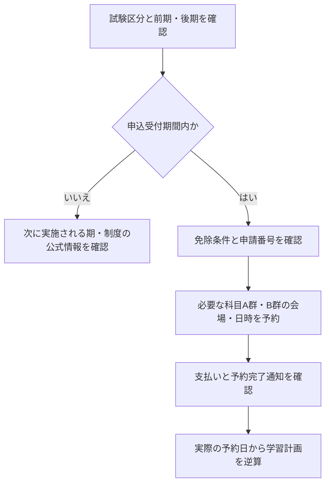

<!-- TARGET_KW: ipa 申し込み 2026 / READER: S3-義務-直前 / 検索 / ANSWER: 区分別の申込期間と科目A・Bの実施期間を照合して予約する / TAKEAWAY: 締切と試験日を区別し、申込済みの科目に合わせて計画する -->

2026年度のIPA試験を申し込みたいのに、前期・後期、科目A・Bの日付が並び、どこを見ればよいか迷っていませんか。

まず分けたいのは「申込期限」と「自分が受験できる期間」です。2026年11月1日時点では、前期の高度・SCは受付終了、APは11月7日17時まで受付期間が続いています。[IPA・令和8年度の申込受付期間](https://www.ipa.go.jp/shiken/2026/ap_koudo_sc_kikan.html)

以下では区分ごとの日程を表で示し、申込済みかどうかによる次の行動も整理します。筆者はAP・高度・SCを未受験です。

後半のChatGPT実行記録は、試験の受験体験とは別のものです。

## 申込期間と試験実施期間の早見表（令和8年度）

IPAが公表している日程を、前期・後期に分けてまとめます。<strong>科目Aと科目Bは別々の期間に実施される</strong>点が、従来の「試験日1日で午前・午後」とは大きく違います。

### 応用情報技術者試験の試験日と前期の申込期間

応用情報は一日固定の試験日ではなく、次の科目別期間内から会場の空席を選びます。

### 前期試験（2026年10月〜12月）

| 区分 | 申込受付期間 | 科目A（A-1/A-2）の実施期間 | 科目B（B-1/B-2）の実施期間 |
|---|---|---|---|
| 応用情報（AP） | 2026年10月6日（火）10時〜11月7日（土）17時 | 2026年10月28日（水）〜11月10日（火） | 2026年11月24日（火）〜12月6日（日） |
| 高度試験（ST・SA・NW・SM） | 2026年10月6日（火）10時〜10月24日（土）17時 | 2026年10月17日（土）〜10月27日（火） | 2026年11月11日（水）〜11月23日（月） |
| 情報処理安全確保支援士（SC） | 2026年10月6日（火）10時〜10月24日（土）17時 | 2026年10月17日（土）〜10月27日（火） | 2026年11月11日（水）〜11月23日（月）（科目Bのみ） |

出典: [IPA・前期の申込受付期間と試験実施期間](https://www.ipa.go.jp/shiken/2026/ap_koudo_sc_kikan.html)（2026年11月1日確認）

### 後期試験（2027年1月〜3月）

| 区分 | 申込受付期間 | 科目A（A-1/A-2）の実施期間 | 科目B（B-1/B-2）の実施期間 |
|---|---|---|---|
| 応用情報（AP） | 2027年1月27日（水）〜2月16日（火） | 2027年2月6日（土）〜2月19日（金） | 2027年3月3日（水）〜3月15日（月） |
| 高度試験（PM・DB・ES・AU） | 2027年1月27日（水）〜2月27日（土） | 2027年2月20日（土）〜3月2日（火） | 2027年3月16日（火）〜3月28日（日） |
| 情報処理安全確保支援士（SC） | 2027年1月27日（水）〜2月27日（土） | 2027年2月20日（土）〜3月2日（火） | 2027年3月16日（火）〜3月28日（日） |

出典: [IPA・後期の申込受付期間と試験実施期間](https://www.ipa.go.jp/shiken/2026/ap_koudo_sc_kikan.html)（2026年11月1日確認）

受験手数料は7,500円です。情報処理技術者試験は税込み、SCは非課税です。[IPA・受験手数料](https://www.ipa.go.jp/shiken/2026/ap_koudo_sc_kikan.html)（2026年11月1日確認）

<strong>注意</strong>: 日程は2026年9月17日更新のIPA公式ページに基づきます。申込前に必ず[IPA公式の申込受付期間・試験実施期間のページ](https://www.ipa.go.jp/shiken/2026/ap_koudo_sc_kikan.html)で最新情報を確認してください。

## 前期試験と後期試験の区分を知る

これまでの「春期試験」「秋期試験」という呼び名は、2026年から<strong>前期試験</strong>および<strong>後期試験</strong>に整理されました。

すべての試験が年2回受けられるわけではなく、区分によって受験できる期が異なります。

### 前期試験で受験できる区分

- 応用情報技術者試験（AP）
- ITストラテジスト試験（ST）
- システムアーキテクト試験（SA）
- ネットワークスペシャリスト試験（NW）
- ITサービスマネージャ試験（SM）
- 情報処理安全確保支援士試験（SC）

### 後期試験で受験できる区分

- 応用情報技術者試験（AP）
- プロジェクトマネージャ試験（PM）
- データベーススペシャリスト試験（DB）
- エンベデッドシステムスペシャリスト試験（ES）
- システム監査技術者試験（AU）
- 情報処理安全確保支援士試験（SC）

<strong>AP・SCは年2回受験可能</strong>ですが、それ以外の高度試験は前期か後期のどちらかのみです。NW・ST・SA・SMを目指すなら前期、PM・DB・ES・AUを目指すなら後期に合わせる必要があります。[IPA・実施区分別の日程](https://www.ipa.go.jp/shiken/2026/ap_koudo_sc_kikan.html)

## 申込から受験までの流れ

申込時には、必要な科目A群と科目B群それぞれの会場・日時を確認します。両群の実施期間が分かれているため、片方だけの日程で予定を決めないでください。[CBT-Solutions・前期の申込手順と出題形式](https://cbt-s.com/examinee/examination/ap_koudo_sc_r8cbt_zenki)

- 申込受付期間内に申し込む（前期は2026年10月6日10時〜。高度・SCは10月24日、APは11月7日が締切）
- 科目Aの実施期間内に1回、科目Bの実施期間内に1回、それぞれ受験する
- 合格には各科目の基準を満たす必要があるため、科目A群の結果だけで残る科目を受けなくてよいと判断しない。[CBT-Solutions・合格基準](https://cbt-s.com/examinee/examination/ap_koudo_sc_r8cbt_zenki)

前期のみのNW・ST・SA・SMは、後期には実施されません。受付終了後に「同じ試験を後期に回す」とはできないため、現在の予約の有無と区分を確かめます。[IPA・前期／後期の実施区分](https://www.ipa.go.jp/shiken/2026/ap_koudo_sc_kikan.html)



申込手順は[CBT-Solutions・令和8年度前期の受験案内](https://cbt-s.com/examinee/examination/ap_koudo_sc_r8cbt_zenki)でも確認してください。免除を受ける場合は、実際に受験が必要な科目を確認して予約します。

### IPA 申し込み 2026：11月1日時点で何をする？

| 状況 | 次の行動 |
|---|---|
| AP前期を未申込 | 11月7日17時の締切と科目A・B双方の空席を確認 |
| 高度・SC前期を申込済み | 科目A群の期間は終了。予約済みの科目B群の日時を確認 |
| NW・ST・SA・SM前期に未申込 | 後期は対象外。次年度の制度・実施案内を確認 |
| AP・SCまたはPM・DB・ES・AUの後期を目指す | 区分の後期日程を確認し、1月27日の受付開始に備える |

日程の根拠: [IPA・申込受付期間及び試験実施期間](https://www.ipa.go.jp/shiken/2026/ap_koudo_sc_kikan.html)

## 応用情報は今年受ける？後期に回す？新試験を待つ？

応用情報技術者試験という名称は、<strong>2026年度で終了する予定</strong>です。

IPAは2027年度の夏〜秋ごろに「プロフェッショナルデジタルスキル試験（仮称）」を新設し、応用情報と高度試験をマネジメント・データ/AI・システムの3区分に再編する方針を示しています。

ただし、これは[IPAの検討状況ページ](https://www.ipa.go.jp/shiken/syllabus/henkou/2025/20260331.html)で公表された<strong>案の段階</strong>で、今後変更される可能性があります。

見直し案どおり進む場合、現行APの最終回に当たるのは後期（2027年2〜3月）です。前期の申込は11月7日までです。

この条件で、自分に合う受け方を選びます。

| 選択肢 | 向いている人 | 学習の進め方 |
|---|---|---|
| 前期（今年）に受ける | すでに学習が進んでいる。履歴書に早く載せたい | 科目Aは[応用情報 科目A模擬試験](/app/ap-quiz/)で演習し、残りの期間で科目Bを固める |
| 後期（最終回）に受ける | 今から学習を始める。前期の受験準備が間に合わない | 前期は見送り、後期の申込開始（2027年1月27日）までを学習期間にする |
| 新試験を待つ | 応用情報の名称にこだわらず、新しい資格体系で受けたい | 20時間コースで基礎を積みながら、IPAの正式発表を待つ |

### 新試験の学習は、応用情報の学習とつながっている

プロフェッショナルデジタルスキル試験は、<strong>応用情報の範囲を土台にして再編される</strong>見込みです。

当サイトの[PD-M（マネジメント）20時間コース](/course/pd-m/)と[PD-S（システム）20時間コース](/course/pd-s/)は、この新試験のシラバス案をベースにしています。

新試験向けのコースだけで現行APの範囲を満たすとは限りません。APを受ける場合は、現行のシラバスと科目Bの過去問題に照らして不足を補います。[IPA・新試験制度のシラバス案](https://www.ipa.go.jp/shiken/syllabus/henkou/2026/20260630.html)

### 判断で見落としやすい点

- 新試験で応用情報の合格実績が優遇される保証はありません。IPAは「現行の高度試験と同等の免除制度を設けることを検討中」としていますが、<strong>詳細は未定</strong>です。
- 新試験の開始時期は「2027年度の夏〜秋ごろ」の予定で、日程は確定していません。
- 就職・転職や社内の資格要件で「応用情報」の名称が必要な場合は、<strong>最終回までに取得する</strong>のが確実です。

試験の再編そのものは[2027年からのIPA試験再編まとめ](/trend/ipa-2027-restructuring/)で詳しく整理しています。区分を選ぶところから確認したい人は[応用情報・高度試験の入口記事](/method/advanced-ipa-hub/)を参照してください。

## ネーミング刷新：午前・午後は科目A・Bへ

試験の形式や内容自体に大きな変更はありませんが、科目の名称が全面的に刷新されます。

| 旧称 | 新称 | 概要 |
|------|------|------|
| 午前Ⅰ試験 | 科目A-1 | 共通基礎（全高度試験共通） |
| 午前Ⅱ試験 | 科目A-2 | 専門基礎（試験区分別） |
| 午後Ⅰ試験 | 科目B-1 | 専門応用（記述） |
| 午後Ⅱ試験 | 科目B-2 | 専門応用（区分により記述・論述） |

2026年度のCBT移行では、出題範囲・出題形式・採点方式・合格基準等に変更はありません。2027年度の制度見直しとは区別してください。[IPA・科目名称と出題範囲](https://www.ipa.go.jp/shiken/2026/ap_koudo_sc_kikan.html)

この対応表は旧名称の読み替えです。すべての区分で科目B-2があるわけではなく、APとSCは科目B、記述式の科目B-2を持つ区分もあります。

科目B-2を一律に「論述」と判断しないでください。[IPA・CBT方式での実施について](https://www.ipa.go.jp/shiken/2026/ap_koudo_sc-cbt.html)

## CBT試験の予約と当日の流れ

CBT試験はこれまでの「一斉試験」と異なり、<strong>受験者自身が試験会場と日時を選んで予約</strong>します。

### 予約のタイミング

希望する会場・日時に空席があるかを、受付期間内に確認します。日程表は実施可能な期間であり、そのすべての日に希望会場の予約枠があるとは限りません。[IPA・試験会場の選択](https://www.ipa.go.jp/shiken/2026/ap_koudo_sc_kikan.html)

### 当日の持ち物と注意点

- 本人確認書類（運転免許証・マイナンバーカード等）
- 鉛筆・消しゴム等の筆記用具は試験センターが提供するため持参不要
- スマートフォン・参考書などは試験室内で使用できません。私物の保管方法は会場案内で確認
- <strong>論述式（科目B-2）はキーボード入力</strong>のため、当日初めて触れないようにCBTの操作感に慣れておく

持参する本人確認書類と私物の扱いは[CBT-Solutionsの当日案内](https://cbt-s.com/examinee/examination/ap_koudo_sc_r8cbt_zenki)、メモ用紙・筆記用具は[IPAの配布案内](https://www.ipa.go.jp/shiken/2026/ap_koudo_sc_kikan.html)で確認してください。

### キャンセル・日程変更

日時・会場の変更期限や申込後の取消の扱いは、[CBT-Solutionsの前期受験案内](https://cbt-s.com/examinee/examination/ap_koudo_sc_r8cbt_zenki)で確認します。空席があることと、変更できることは別です。

### 基本情報技術者試験日程変更・情報セキュリティマネジメントの日程変更

FE・SG・ITパスポートは上のAP・高度・SCの期間表とは別です。ただし通年区分でも休止予定があります。

2026年11月1日時点のIPA案内では、システムリプレースによる休止は2026年12月28日以降、会場によってはそれより前からとなり、再開時期は決まり次第公表とされています。[IPA・2026年5月以降の試験実施について](https://www.ipa.go.jp/shiken/2026/cbt-202605-jisshi.html)

日程を変更したい場合は、変更期限に加え「選べる最後の試験開催日」を確認してください。予約を先延ばしにしても、休止期間を越えて自由に選べるとは限りません。

## 科目A-1（午前I）免除を賢くハックする

高度試験を目指す上で最大の味方が、<strong>科目A-1（旧午前Ⅰ）の免除制度</strong>です。

応用情報（AP）か高度試験・SCに合格するか、高度試験・SCの科目A-1（旧午前Ⅰ）で基準点以上をとれば、<strong>その後2年間は科目A-1の受験が免除</strong>されます。

令和8年度の対象は、IPAの公式ページで次のように案内されています。

| 受ける試験 | 免除を申請できる人 |
| --- | --- |
| 令和8年度前期 | 令和6年度春期〜令和7年度秋期のAP・高度・SCの合格者、高度・SCの午前Ⅰ通過者 |
| 令和8年度後期 | 令和6年度秋期〜令和8年度前期のAP・高度・SCの合格者、令和6年度秋期〜令和7年度秋期の午前Ⅰ通過者、令和8年度前期の科目A-1通過者 |

出典: [IPA・科目A-1免除と対象期](https://www.ipa.go.jp/shiken/2026/ap_koudo_sc_kikan.html)

免除は自動では適用されません。<strong>受験申込みのときに「一部免除申請番号」を入力した場合だけ</strong>免除になります。

合格者は合格証書番号、午前Ⅰ通過者は午前Ⅰ通過者番号を入力し、どちらも受験者マイページで確認できます。[IPA・免除の申請方法](https://www.ipa.go.jp/shiken/about/koudo_menjo.html)

免除されるのは共通知識の科目A-1だけです。科目A-2（専門知識）と科目Bの対策は、引き続き必要です。

2027年度からは新試験制度に移る予定です。IPAは、現行の制度で免除の条件を満たした人について、新試験でも一部の科目を免除することを検討していると案内しています。

（出典: [科目A-1試験免除｜IPA](https://www.ipa.go.jp/shiken/about/koudo_menjo.html)、[令和8年度の申込受付期間及び試験実施期間｜IPA](https://www.ipa.go.jp/shiken/2026/ap_koudo_sc_kikan.html)）

次は、筆者が2026年10月28日に実行した元のプロンプトです。免除判定は公式の条件表で行い、AIの回答は確認対象として読みます。

```text
科目A-1（午前Ⅰ）免除条件の確認プロンプト：

あなたはIPA情報処理技術者試験の制度に詳しいアドバイザーです。
私は[試験区分名]を受験予定です。
以下の受験歴で2026年度の科目A-1免除を受けられるか教えてください：
・[直近の合格試験と年月]
・[直近の午前Ⅰ通過と年月]

また、免除を活用した場合の最適な学習スケジュールも提案してください。
```

### ChatGPTで実行した結果

このプロンプトを、ChatGPT（無料プラン）で実行しました（2026年10月28日）。受験歴は<strong>架空の例</strong>で、「ネットワークスペシャリスト試験を受験予定、応用情報 令和6年度秋期 合格、午前Ⅰ通過なし」と入れています。

回答は、免除の判定、申請の方法、日程の注意、学習スケジュールの4部構成でした。IPAの公式ページと照らし合わせた結果は次のとおりです。

| 回答の内容 | 公式と照らした結果 |
| --- | --- |
| 令和6年度秋期のAP合格で、科目A-1の免除を受けられる | 合っている（前期・後期とも対象） |
| 午前Ⅰの通過実績は要らない | 合っている（条件はどれか1つでよい） |
| 申込み時に、合格証書番号を一部免除申請番号として入力する | 合っている |
| 免除されるのは科目A-1だけで、科目A-2と科目Bの対策は必要 | 合っている |
| NWの前期の申込は10月24日17時に締め切り済み、科目Bは11月11日〜23日 | 合っている |
| NWは後期試験では受けられない | 合っている |
| 前期は「2026年11月頃」、後期は「2027年2月頃」 | 大まかすぎる。前期の科目Aは10月17日〜27日に始まっている |
| 申込み済みなら、10月28日〜31日は科目A-2の過去問演習をする | <strong>間違い</strong>。NWの科目A-2は10月27日に終わっている |

制度の説明はほぼ正確でした。ただ、<strong>学習スケジュールの最初の行が、もう終わった試験の対策</strong>になっていました。

CBT方式では、申込みのときに科目Aと科目Bを同時に予約します。10月28日の時点で申込み済みの人は、科目Aをすでに受け終わっていて、残りは11月11日からの科目Bだけです。

日付の入った計画は、どの部分が終わっているかを、[早見表](#申込期間と試験実施期間の早見表令和8年度)で確かめてから使ってください。

> [!exp]
> とてもそれらしく書かれていますが、AIの回答なので、すべてを信用しきることはできません。公式を見たほうが確実、という結論にもつながります。AIにはスケジュール作りだけを頼むほうがいい場合もあります。試験日を予約して申し込みを済ませたら、勉強期間の最大はもう決まっています。そのうえで、習熟度に合わせて期間内の配分を都度調整する必要があります。ある程度学習済みなら全期間を復習や過去問に当てればいいですが、ゼロから学ぶなら「人間の疲労」も考える必要があります。このスケジューリングで、将来あるかもしれないマネジメントを体感しているはずです。

免除の判定は公式ページの表で自分で確かめ、AIには「科目Bまで残り◯日、1日◯時間」のように条件を渡して、計画だけを作ってもらう使い方もできます。

### 予約済みの科目Bから学習計画を作る追加プロンプト

次は免除の可否をAIに判定させず、確認済みの予約日だけを渡す方法です。実際の入力には、自分の科目名と日時を使います。

```text
公式案内と予約完了通知で確認済みの条件だけを使って、学習計画を整理してください。
今日の日付：[年月日]
受験区分：[区分]
科目A群の受験状況：[受験済み／免除等]
残っている科目と予約日時：[科目名・年月日・時刻]
使える学習時間：[平日・休日]
苦手分野：[分野]

終了した科目の対策は計画に含めないでください。
制度・免除・日程を推測で追加せず、不足情報は質問してください。
最初に、学習対象の科目と利用可能な日数を示してください。
```

<!-- AI_EXAMPLE: 使うAI=ChatGPT / プロンプト=予約済みの科目Bから学習計画を作る追加プロンプト / 見せたいこと=終了した科目A群を計画に混ぜないか、予約日と学習可能日数を照合する（筆者が実行して記録） -->

## よくある質問

<strong>Q: 2026年度の応用情報の申込はいつからですか？</strong>

A: 前期は<strong>2026年10月6日（火）10時から11月7日（土）17時まで</strong>です。後期は2027年1月27日（水）から2月16日（火）までです。

従来の春期試験にあたる4月の申込はありません。 [IPA・日程と実施区分](https://www.ipa.go.jp/shiken/2026/ap_koudo_sc_kikan.html)

<strong>Q: 高度試験（NW・ST・SA・SMなど）の前期の申込締切はいつですか？</strong>

A: <strong>2026年10月24日（土）17時</strong>で、2026年11月1日時点ではすでに締め切られています。APより締切が約2週間早い区分でした。

NWなど前期のみの区分は後期には実施されないため、次年度の制度・日程の案内を確認してください。 [IPA・日程と実施区分](https://www.ipa.go.jp/shiken/2026/ap_koudo_sc_kikan.html)

<strong>Q: 応用情報の試験はいつ受けられますか？</strong>

A: 前期は科目Aが2026年10月28日〜11月10日、科目Bが11月24日〜12月6日の期間内で、自分で日時を選んで受験します。後期は科目Aが2027年2月6日〜2月19日、科目Bが3月3日〜3月15日です。 [IPA・日程と実施区分](https://www.ipa.go.jp/shiken/2026/ap_koudo_sc_kikan.html)

<strong>Q: 科目Aと科目Bは別の日に受けるのですか？</strong>

A: はい。実施期間が別々に設定されています。

必要な科目A群と科目B群の会場・日時の両方を確認して申し込んでください。[CBT-Solutions・受験案内](https://cbt-s.com/examinee/examination/ap_koudo_sc_r8cbt_zenki)

<strong>Q: 論述式のCBT化は難易度が上がりますか？</strong>

A: 出題内容・採点基準に変更はありませんが、<strong>手書きからタイピング入力になる</strong>ため、操作に慣れていない方は事前練習が必要です。必要な入力速度の一律の数値は示せません。

自分の答案を制限時間内に入力・見直しできるかで練習量を決めます。詳しくは[応用情報・高度試験のCBT化と2027年度の新試験制度](/method/cbt-2026-syllabus-complete-guide/)を参照してください。

<strong>Q: 応用情報技術者試験は2026年度で終わるのですか？</strong>

A: IPAは2026年度での終了を予定していますが、現時点では<strong>検討中の案</strong>で、変更の可能性があります。案どおりなら現行APの最終回は後期（2027年2〜3月）で、2027年度の夏〜秋ごろに「プロフェッショナルデジタルスキル試験（仮称）」が新設される予定です。

前期・後期・新試験のどれを選ぶかは、本記事の「応用情報は今年受ける？後期に回す？新試験を待つ？」の節で整理しています。 [IPA・日程と実施区分](https://www.ipa.go.jp/shiken/2026/ap_koudo_sc_kikan.html)

<strong>Q: FE（基本情報技術者試験）・ITパスポート・SGの日程は変わりますか？</strong>

A: 今回のAP・高度・SCの期間表の対象外です。ただし2026年12月28日以降は休止予定で、会場により早く休止する場合もあります。[IPA・休止時期の案内](https://www.ipa.go.jp/shiken/2026/cbt-202605-jisshi.html)（2026年11月1日確認）


---

## まとめ：前期のAPは11月7日まで、次は後期

2026年度の応用情報・高度・SC試験の日程のポイントは、次のとおりです（2026年11月1日確認）。

- <strong>高度・SC（前期）</strong>: 申込は10月24日17時に締切済み。科目Aの実施は10月17日〜27日、科目Bは11月11日〜23日
- <strong>AP（前期）</strong>: 申込締切は11月7日。科目Aは10月28日〜、科目Bは11月24日〜
- <strong>後期</strong>: 申込は2027年1月27日から。学習が間に合わない人は後期に狙いを定める
- <strong>応用情報の最終回</strong>: 2026年度で終了する予定（案の段階）。名称が必要なら後期までに取得し、新試験を待つなら免除制度の正式発表を確認する

日程を押さえたら、次は試験区分の選び方とAIを使った学習計画そのものを固めましょう。[新IPA試験の勉強法｜区分選びとデータ・AIを使った学習計画](/method/new-ipa-exam-study-strategy/) で、区分別の学習時間の目安とAI活用のロードマップを解説しています。


## 参考

- [令和8年度 応用情報技術者試験、高度試験及び情報処理安全確保支援士試験の申込受付期間及び試験実施期間について（IPA）](https://www.ipa.go.jp/shiken/2026/ap_koudo_sc_kikan.html)
- [2026年度のCBT方式への移行（IPA）](https://www.ipa.go.jp/shiken/2026/ap_koudo_sc-cbt.html)
