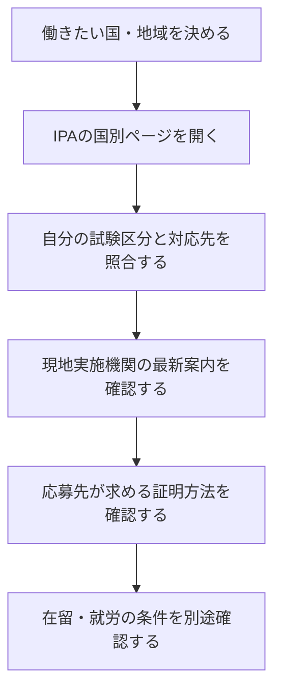

<!-- TARGET_KW: 情報処理技術者試験 相互認証 海外 -->
<!-- READER: S2-武器-検討前 / 検索｜日本のIT試験を海外就職に使えるか検討する人 -->
<!-- ANSWER: 相互認証は対象試験の出題範囲などの同等性の認証であり、国別対応・採用・在留条件をそれぞれ確認する。 -->
<!-- TAKEAWAY: 対応表の読み方、能力評価と資格・ビザの区別 -->

「基本情報技術者に合格すれば、海外でも同じ資格を持っている扱いになるのか」。相互認証を調べるときは、知識水準の評価と、現地で働くための手続を分ける必要があります。

この記事では、IPAの国別対応表を使い、自分の試験区分が何に対応するか、応募やビザの確認へどうつなげるかを整理します。

## 情報処理技術者試験の相互認証は、何を認める制度か

IPAの相互認証は、日本と各国・地域の試験実施機関が、対象試験の出題範囲などを同等レベルと認める仕組みです。2026年10月31日に確認した公式説明では、協力関係はアジア12か国・地域とされています。[出典：IPA「情報処理技術者試験の海外との相互認証について」](https://www.ipa.go.jp/shiken/asia/mutual-recognition/about.html)

この説明から読み取れるのは、能力評価の共通のものさしとして利用する制度だということです。「協定がある国なら、すべてのIPA試験が対応する」とは判断できません。

また、出題範囲の同等性を認めることから、現地資格の合格証が自動交付される、必ず採用される、とまでは読み取れません。必要な効力ごとに、次の窓口を使い分けます。

| 知りたいこと | 確認する資料・相手 |
| --- | --- |
| 自分の試験が認証対象か | IPAの国別相互認証ページ |
| 現地の証明書や登録を得られるか | 現地の試験実施機関の手続案内 |
| 採用条件を満たすか | 応募先の求人票・採用担当者 |
| その国で働けるか | 渡航先の入管・大使館などの在留・就労条件 |

## 国別対応表は、国名と試験区分をセットで読む

例えば、IPAのベトナムのページには、日本側のITパスポート・基本情報技術者・応用情報技術者に対応する区分が掲載されています。これは同ページの対応例であり、ほかの国にそのまま適用する一覧ではありません。[出典：IPA「相互認証：ベトナムの試験制度について」](https://www.ipa.go.jp/shiken/asia/mutual-recognition/vietnam.html)

確認する順番は次のとおりです。

IPAの国別ページには古い更新日のものもあります。対応関係の入口として使い、申請先や現在の実施状況は現地実施機関でも確認しましょう。

国別ページへの入口は[IPA「海外との相互認証」](https://www.ipa.go.jp/shiken/asia/mutual-recognition/index.html)です。

## ITPECと相互認証は、同じ名称の制度ではない

ITPECはIT Professionals Examination Councilの略で、試験実施機関の協議会を指します。日本の試験をベースにしたアジア共通統一試験は、相互認証に基づく取組の一つです。[出典：IPA「アジア共通統一試験について」](https://www.ipa.go.jp/shiken/asia/itpe.html)

相互認証を結んだ国が、すべて同じ実施日・同じ区分の共通試験を行っていると考えないようにします。制度の関係と、いま申し込める試験の情報は分けて確認します。

## 日本への在留資格の特例を、海外就職へ逆向きに当てはめない

IPAは、法務省告示に定められた試験・資格の合格者などについて、日本の「技術・人文知識・国際業務」の在留資格に係る学歴・実務経験の基準の特例を説明しています。[出典：IPA「海外との相互認証について」制度の効果](https://www.ipa.go.jp/shiken/asia/mutual-recognition/about.html)

これは、日本に入国して働く場合の特例です。この記述を根拠に「日本の合格者も、相手国の就労ビザで同じ優遇を受ける」と判断することはできません。

海外で働く条件を確認するときは、渡航先・国籍・就労内容・雇用形態などを明らかにし、その国の現行の案内へ進みます。本記事では、特定国のビザ取得可否までは扱いません。

## 応募書類では、合格区分と対応の根拠を分けて示す

例えば基本情報技術者の合格者がベトナムの企業へ応募するなら、「日本で合格した試験の正式名称」と「IPAの対応表」を分けて説明すると、確認する側が追いやすくなります。

- 求人に日本の試験名が明記されている → 合格した区分と証明方法を照合する。
- 現地の試験名だけがある → 相互認証の対応表を添え、応募条件として認めるか問い合わせる。
- 実務経験や語学力が必須になっている → 相互認証だけで免除されると考えず、各条件を確認する。
- 合格していない区分の知識を学んだだけ → 合格資格として記載せず、学習した内容として説明する。

これは応募の説明方法の提案であり、採用評価や優遇を保証するものではありません。

---

## まとめ：対応関係と、必要な効力を照合する

情報処理技術者試験の相互認証は、国と試験区分を指定して読む制度です。出題範囲の同等性、現地資格の手続、採用、在留資格の条件を分ければ、次に確認する相手が分かります。

基本情報の取得を検討する段階なら、[基本情報技術者の合格ロードマップ](/method/fe-hub/)で学ぶ範囲を確認してください。ITパスポートから始める場合は[合格ロードマップ](/method/itp-hub/)と[20時間コース](/course/ip/)が入口です。

本記事は海外就職や未受験資格の受験体験ではなく、公式制度と確認手順を整理したものです。
