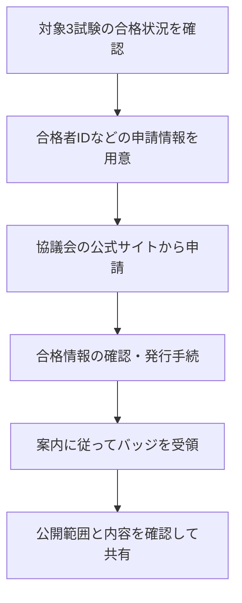

<!-- TARGET_KW: IPA オープンバッジ 合格証明 -->
<!-- READER: S3-実利-検討前 / 検索｜IT資格のバッジを会社への合格証明に使いたい人 -->
<!-- ANSWER: DX推進パスポートは公的な合格証明の代替ではなく、提出先が求める証書・証明書を確認する。 -->
<!-- TAKEAWAY: バッジと合格証明の区別、3試験の対象、共有時の確認 -->

「IPAのオープンバッジを取得すれば、会社に合格証明として提出できるのか」。ここで確かめたいのは、バッジの見た目より、発行者が何を証明し、提出先が何を求めているかです。

この記事では、DX推進パスポートと試験の合格証書・合格証明書を分けて整理します。取得済みの資格を共有するとき、目的に合う証明方法を選べるようにします。

## IPAのオープンバッジを探す前に、制度名を確かめる

ITパスポートに関係するバッジとして、デジタルリテラシー協議会の<strong>DX推進パスポート</strong>があります。2026年10月31日時点の対象は、ITパスポート試験、DS検定リテラシーレベル、G検定の三つです。[出典：デジタルリテラシー協議会「DX推進パスポート」](https://www.dilite.jp/passport)

IPAは同協議会を構成する団体の一つです。IPAの紹介記事でも、DS協会、JDLAとともに管理・発行・運営に関わる仕組みとして説明されています。[出典：IPA DX SQUARE「DX推進パスポートとは？」](https://dx.ipa.go.jp/dx-suishin-passport)

したがって、「IPAの試験なら、どの合格者にも同じオープンバッジが自動発行される」と考えず、バッジの正式名称と対象試験を確認します。

## DX推進パスポートは、公的な合格証明の代替ではない

協議会の公式案内は、DX推進パスポートが各試験の合格を公的に証明するものではないと明記しています。ITパスポートの公的な合格証明としては、経済産業大臣の合格証書、またはIPAの合格証明書を挙げています。[出典：協議会「補足と注意事項」](https://www.dilite.jp/passport)

| 用途・条件 | 選ぶもの | 理由 |
| --- | --- | --- |
| 会社や学校に公的な合格証明を求められた | 指定された合格証書・合格証明書 | DX推進パスポートの画像だけで代用しない |
| 学んだ領域をプロフィールで紹介したい | DX推進パスポートの共有情報など | バッジの内容を確認できる形で示す |
| 提出先がデジタルバッジ可と書いている | 受け付けるバッジの種類を確認 | 「可」でも、どの制度のバッジかは別の確認 |
| 合格証書を紛失し、証明が必要 | IPAの合格証明書の手続を確認 | 合格証書は再発行されない |

合格証書と合格証明書は名称が似ていますが、別のものです。IPAは、合格証書は再発行できず、合格証明書は合格発表後に申請できると案内しています。申請受付の状況は公式ページの最新のお知らせも確認してください。[出典：IPA「合格証明書の交付手続き」](https://www.ipa.go.jp/shiken/goukaku/shinsei_01.html)

## 対象となる三つの試験と申請の流れ

DX推進パスポートは、対象の三試験のうち、一種類の合格で「1」、二種類で「2」、三種類すべてで「3」となります。基本情報や応用情報、情報セキュリティマネジメントを組み合わせる制度としては案内されていません。[出典：協議会「DX推進パスポートとは？」](https://www.dilite.jp/passport)

申請に必要な情報や手順は、[協議会の申請案内](https://www.dilite.jp/passport)を使用します。自動発行を待つ前に、申請済みかどうかを確認しましょう。

ここでの図は案内の要約です。発行までの日数や費用など、変更されうる条件は申請時の公式案内で確認してください。

## オープンバッジで確かめるのは、発行者と達成条件

オープンバッジは、単なる画像ではなく、発行者・達成条件・取得者への参照などの情報を含む、検証・共有可能な形式です。標準は現在1EdTechが定めています。[出典：1EdTech「CLR and Open Badges FAQ」](https://www.1edtech.org/clr/faq)

バッジを確認するときは、次の情報を見ます。

- 誰が発行したか。
- 何の試験や学習を、どの条件で達成したものか。
- 誰に発行されたもので、必要な有効期限の条件があるか。
- 提示された情報を、発行元や検証用のリンクで確認できるか。

「画像を持っていること」と「発行元が確認できること」は別です。また、オープンバッジという名称だけから、特定のブロックチェーン技術が使われていると推測しないようにします。

## 履歴書やプロフィールでは、証明する範囲を広げない

バッジは、達成した内容を相手が確認する入口になります。ただし、知識の学習・試験の合格から、実務での成果や職務経験まで自動的に証明されるわけではありません。

例えば、DX推進パスポートを記載するときは、正式名称と、合格した対象試験を区別して書きます。公開ページで氏名などがどこまで見えるかも、共有前に確認します。

選考や社内評価でどの程度重視されるかは提出先によります。「採用で有利になる」と一律に期待するより、相手が必要とする情報を過不足なく伝える使い方が適しています。

---

## まとめ：提出先の目的から、証明方法を選ぶ

DX推進パスポートとITパスポートの公的な合格証明は、役割が違います。会社へ提出するなら指定書類を、プロフィールで紹介するなら発行者や内容を確認できる共有方法を選びましょう。

これからITパスポートを学ぶ場合は、[合格ロードマップ](/method/itp-hub/)と[20時間コース](/course/ip/)で学習範囲を確認できます。

本記事はバッジ取得の体験記ではなく、2026年10月31日に確認した公式案内をもとにした制度解説です。
