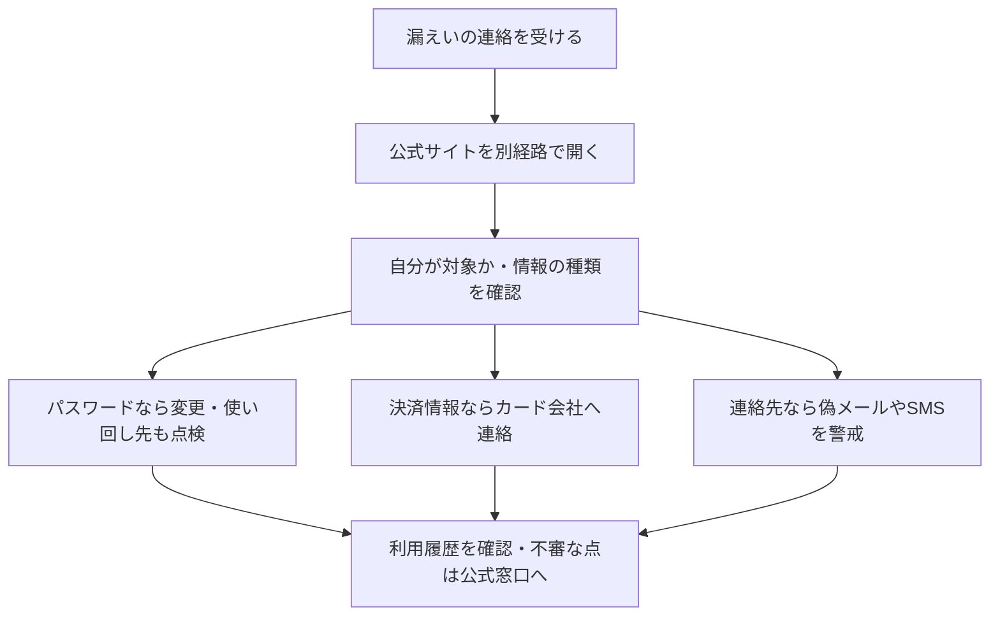

---

情報漏えい対策は、漏れた情報が「パスワード」「決済情報」「連絡先」のどれかを確認し、必要な行動を選ぶことが出発点です。企業側の流出を個人が止めることはできませんが、被害を広げない備えはできます。

## 2026年9〜10月に、何が起きているのか

9月から10月にかけて、大規模な情報漏えいの発表が続いています。各発表時点の主な事案は次のとおりです。続報の確認日は2026年11月16日です。

| 発表時期 | 事案 | 規模・内容 |
| --- | --- | --- |
| 9月11日 | デジタル庁が運用する政府共通の業務基盤（GSS）への不正アクセス | 約24万6000件が漏えいした可能性。対象は職員や業務関係者で、一般の方の情報は含まない（[9月11日発表](https://www.digital.go.jp/news/2026-0911-01)） |
| 10月1日 | 佐川急便の「お荷物問い合わせサービス」への不正アクセス（9月30日に確認） | 個人情報流出の可能性を調査し、サービス再開を公表（[佐川急便の第5報](https://www2.sagawa-exp.co.jp/information/detail/430/)）。対象範囲は続報で確認 |
| 10月2日 | 第一ライフグループ・第一生命が使う従業員向け人事システムへの不正アクセス | 現役・退職者の情報。対象は約12.4万人に更新、保険契約者等の顧客情報への不正アクセスは確認されず（[10月27日調査結果](https://www.daiichilife-group.com/news/assets/pdf/portalaccess2.pdf)） |
| 10月5日 | 焼肉きんぐ運営会社（物語コーポレーション）の公式アプリ | 会員情報1078万8963件が漏えい。パスワード・決済情報は対象外（[10月5日発表](https://www.yakiniku-king.jp/news/6875/)） |

被害に遭っているのは、特別に守りが弱い会社だけではありません。官公庁も、大手企業も、日常で使うアプリも対象になっています。

## 「自分のデータは自分で守る」は正しいのか

企業が情報を漏らさないようにする責任と、利用者が二次被害に備える行動は、分けて考えます。たとえばデジタル庁のGSSの公表資料でも、漏えいの可能性を説明したうえで、不審な連絡やリンクに注意するよう呼びかけています。[デジタル庁の公表資料](https://www.digital.go.jp/news/2026-0911-01)

守る責任と備えを、次の2つに分けて整理します。

- <strong>預かった側（企業・行政）の責任</strong>：システムを守り、漏らさないこと。漏えいしたときに、早く正確に知らせること
- <strong>預けた側（私たち）にできること</strong>：漏えいが起きても、被害が広がらないようにしておくこと

預けたデータが外へ出る事故は、個人には止められません。だからこそ、私たちにできるのは「漏れる前提で、被害を小さくしておく」ことです。「自分で守る」は、事故を防ぐ意味ではなく、<strong>被害を最小にする備え</strong>と考えるのが現実的です。

## 個人でできる対策5つ

### パスワードの使い回しをやめる

漏えいした情報の中にIDとパスワードが含まれると、攻撃者はそれを別のサービスで試します。使い回しをしていると、1つの漏えいから、メール・通販・SNSへと被害が連鎖します。

対策は単純です。

- サービスごとに、別のパスワードにする（覚えきれないなら、パスワードマネージャーを使う）
- 長く、推測されにくいものにする
- 漏えいの連絡が来たサービスは、すぐにパスワードを変える。同じパスワードを使っている他のサービスも、同時に変える

### 多要素認証とパスキーを有効にする

パスワードが盗まれても、もう1つの確認が必要なら、不正ログインを止められます。メール・通販・金融・SNSから、順に設定してください。

仕組みと種類の違いは、[多要素認証（MFA）の解説](/theory/cyber-attack-countermeasures-basics/)で整理しています。使えるサービスでは、パスキー（端末の指紋・顔認証で、パスワードなしにログインする方式）への切り替えも、有効な選択肢です。

### 預けるデータを減らす

流出する情報は、預けていなければ流出しません。

- 使っていないアプリ・会員登録は、退会する
- 登録するときは、必須でない項目（生年月日・住所など）を入れない
- 「ポイントがつくから」という理由だけで、会員登録をしない

### 漏えいの連絡が来たあとの行動を決めておく

漏えいの被害を大きくするのは、連絡が来たあとの「放置」です。連絡を受けたら、次の順に動きます。

1. 連絡が、公式の発表や公式アプリ・サイトで確認できるか調べる（メール内のリンクは開かない）
2. 該当のサービスのパスワードを変更する。同じパスワードの他のサービスも変更する
3. クレジットカード情報が含まれるなら、カード会社に連絡する。明細も確認する
4. 住所・電話番号・メールアドレスが含まれるなら、<strong>この後のフィッシング（偽のメール・SMS）に警戒する</strong>



複数種類が漏れたなら対応も併用します。漏れていない情報まで一律に扱わず、公式発表の対象と除外事項を読みます。職場の情報なら、自分だけで判断せず所定の報告先へ連絡してください。

### 漏えい後のフィッシングに備える

名前・住所・電話番号が漏れると、本物らしい偽のメールやSMSが届きやすくなります。「荷物の不在通知」「会員情報の更新」「アカウントの停止」といった、焦らせる文面が典型です。

- メール・SMSのリンクからは、ログインしない。公式アプリや、自分でブックマークしたサイトから開く
- 急がせる文面ほど、一度止まる
- 少しでも不審なら、公式の窓口に、別経路で確認する

### 特定の人を狙う「標的型メール」の見分け方

漏えいした情報をもとに、特定の組織や個人を狙って送られるのが<strong>標的型メール</strong>です。不特定多数に送る迷惑メールと違い、上司や取引先になりすまし、業務に関係する件名で送られてくるため、見分けにくくなります。人の心理的な隙を突く手口は、<strong>ソーシャルエンジニアリング</strong>と呼ばれます。

次の点に注意してください。

- 送信元のメールアドレスが、本物と微妙に違う
- 不自然な敬語や言い回しがある。急ぎの依頼や、決まりを飛ばすよう求める
- 添付ファイルの形式が、ふだんの業務で使わないもの（実行ファイルや、圧縮ファイルの中のスクリプトなど）である
- 本文中のURLのドメインが、正規のものと違う

開いてしまったときは、次の順に動きます。

1. 端末を、ネットワークから切り離す（マルウェアが社内に広がるのを防ぐため）
2. 情報システム部門や上司に、すぐ報告する（専門家による調査と、全社への共有につなげるため）

報告が遅れるほど、被害は広がります。叱られることを恐れて隠さないでください。

組織では、標的型メールに見せかけた訓練メールを送って、社員の気づきを高める方法もあります。訓練は、評価のためではなく、自分の弱点に気づくための機会です。

生成AIに、訓練用の例文を作ってもらうと、見分ける練習ができます。

```text
あなたはセキュリティコンサルタントです。社員教育のために、取引先を装った標的型メールの例文を150文字以内で作ってください。
そのあと、**そのメールのどこが怪しいか**を3点、指摘してください。
```

標的型メールは、ITパスポートや情報セキュリティマネジメント試験でも問われる、代表的な脅威です。

## 職場でできる対策：生成AI時代の落とし穴

職場の対策で、いま見落とされやすいのが生成AIです。デル・テクノロジーズが2026年9月29日に発表した調査（中堅中小企業・大企業の815人が回答）では、次の結果が出ています。

- 生成AIを何らかの形で利用している組織は<strong>95.7%</strong>
- 過去1年間に生成AI関連のセキュリティ上の問題を経験したのは<strong>78.5%</strong>
- 経験した問題の内訳は、情報漏えいが20.2%で最多。不正アクセスが16.9%、マルウェア感染が14.1%
- 生成AI利用で最も懸念する事項は「機密情報の漏えい」で25.8%

この調査は、従業員300人以上の企業で、PC・業務端末の導入・運用・管理やセキュリティ対策に関わる人が回答しており、小規模企業や一般の従業員全体の実態を示す数字ではありません。[デル・テクノロジーズの調査発表](https://prtimes.jp/main/html/rd/p/000000429.000025237.html)それでも、ほとんどの組織で生成AIが使われ、同時に不安も大きいという方向性は読み取れます。

職場では、次の4つから始めてください。

- <strong>入れてよい情報の線引きを決める</strong>：顧客の個人情報、未公開の財務・人事情報、パスワード・APIキーは、生成AIに入れない。決めていない職場は、まず上司や情報システム部門に確認する
- <strong>会社が認めたAIを使う</strong>：個人アカウントの無料版に、業務の情報を入れない。履歴を学習に使う設定かどうかも、確認する
- <strong>PC・OS・アプリを更新する</strong>：調査では、攻撃の被害拡大の起点として最も注意すべきものに「PC・モバイル端末の侵害」（24.3%）が挙がっています（[調査の設問5](https://prtimes.jp/main/html/rd/p/000000429.000025237.html)）。更新を後回しにしない
- <strong>起きたら、すぐ報告する</strong>：誤送信・紛失・怪しいリンクを開いたときは、隠さず、すぐ報告する。報告が早いほど、被害は小さく済みます

同じ調査で、今後1年間の優先投資は「従業員教育・利用ルール整備」が17.5%、「端末保護・可視化」は7.1%でした。教育とルールが、対策の入口として重視されていることが分かります。[同調査の設問7](https://prtimes.jp/main/html/rd/p/000000429.000025237.html)

## 経営トップが決めること｜自社が狙われなくても、業務は止まる

サイバー攻撃が経営の問題になるのは、自社が狙われたときだけではありません。自社が使うサービスや取引先が止まったときも、受発注や出荷が止まります。その備えをするのか、受け入れるのか。決めるのは現場ではなく、経営トップです。

### ランサムウェアの被害は、中小企業にも広がっている

警察庁の令和8年上半期の資料では、被害組織へのアンケートで侵入経路の約5割がVPN機器とされています。未修正の脆弱性や漏えいした認証情報が悪用されるため、VPNを入れただけで安全とは判断できません。[警察庁の公表資料（本文10頁）](https://www.npa.go.jp/publications/statistics/cybersecurity/data/R8kami/R08_kami_cyber_jousei.pdf)

点検の出発点は、VPNなどの機器と管理者を一覧にし、更新状況と外部からの接続方法を確認することです。

IPAの「情報セキュリティ10大脅威 2026」（組織編）でも、ランサム攻撃による被害、サプライチェーンや委託先を狙った攻撃、AIの利用をめぐるサイバーリスク（初選出）が上位に並びました。[IPA「情報セキュリティ10大脅威 2026」](https://www.ipa.go.jp/security/10threats/10threats2026.html)

### 取引先が止まれば、自社も止まる

自社の受発注や物流が取引先のシステムに依存していれば、相手が止まったときの代替手段も点検が必要です。

経済産業省と国家サイバー統括室は、SCS評価制度の構築方針を2026年3月に公表しています。開始日を確定事項として扱わず、取引先から要求される対策の確認に使います。[経済産業省の公表資料](https://www.meti.go.jp/press/2025/03/20260327001/20260327001.html)

制度の前段として、IPAの「SECURITY ACTION」や「中小企業の情報セキュリティ対策ガイドライン」があり、中小企業はまず[IPAの対策ガイドライン](https://www.ipa.go.jp/security/guide/sme/about.html)から、自社の不足を確認できます。

### 守れた領域と、守れなかった領域

2024年6月のKADOKAWAグループへの攻撃では、複数のサーバーへのアクセス障害が起き、ランサムウェアを含む攻撃と確認されました。[KADOKAWAの2024年8月5日発表](https://www.kadokawa.co.jp/topics/12088/)

事前に投資した領域では侵害を防げても、守る範囲が全体に及ばなければ、サービスは止まりえます。管理者が決まっていない部門のWebサイトや、更新が止まったサイトも棚卸しの対象に含めましょう。守る対象は、社内のシステムだけでなく、インターネットを通じて提供しているサービスのすべてです。

### トップが決める3つのこと

トップが自分で決めることは、次の3つに絞れます。

1. <strong>責任者を決める</strong>：CISOまたは相当の役職を決め、役員会への定期報告を求める。専任が難しい中小企業は、責任者を一人決めて、定期的に報告させるところから始める。多要素認証を経営陣から率先して使う、訓練に役員も参加するなど、トップ自身が手本を示す
2. <strong>範囲を決める</strong>：守る対象を一度、棚卸しする
3. <strong>許容を決める</strong>：リスクをどこまで受け入れるかを決める

経済産業省とIPAの「サイバーセキュリティ経営ガイドライン」は、経営者が認識すべき原則として、リーダーシップをとって対策を進めること、サプライチェーン全体のリスクに目を向けること、平時から緊急時まで関係者とコミュニケーションをとることを示しています。[経済産業省・IPA「サイバーセキュリティ経営ガイドライン」](https://www.meti.go.jp/policy/netsecurity/mng_guide.html)

守る範囲の棚卸しでは、次の表の領域ごとに確認します。

| 領域 | 確認すること |
| --- | --- |
| VPN・境界機器 | 最新のパッチが当たっているか、不要なアカウントや古い設定が残っていないか |
| 公開サイト・EC | 管理者が不明なサイトや、更新が止まったサイトがないか |
| クラウド | 投資して守っている領域と、まだ整備できていない領域の線引きはどこか |
| AI利用 | 承認済みのツールは何か、入力してよい情報は何か |
| 取引先 | 重要な取引先が止まったとき、代わりの手段があるか |
| 人・体制 | 責任者は誰か、報告ラインは決まっているか、教育はしているか |

許容を決めないことも、リスクを何もせずに受け入れる、という選択です。次の質問に、すぐ答えられるでしょうか。

- 主要な取引先のシステムが2週間止まったら、自社の業務はどうなるか
- 自社の公開サイトが改ざんされたら、誰が何を判断するか
- 社員が未承認のAIに顧客情報を入力していないと、どう確かめるか

答えに詰まるなら、それが最初に決めるべき項目です。

### AIと一緒に、役員会向けの机上演習を作る

「自分の会社で起きたらどうなるか」を考えるには、具体的な場面を想像するのが近道です。AIに答えを出させるのではなく、AIに問いを投げてもらい、自分で判断します。

```text
あなたは、中小企業の経営者を支援するセキュリティ顧問です。
私は【業種・従業員数】の会社の【役職】です。
主なシステムは【例：基幹システム、自社EC、クラウド会計、VPN】です。
次の想定で、私が経営者として判断すべき論点を、質問の形で**1つずつ**投げかけてください。
想定：**主要な取引先のシステムが2週間停止し、受発注が止まった**
- 私が答えるまで、次の質問に進まないでください
- 私の答えに、**判断が抜けている点**や**前提が曖昧な点**があれば指摘してください
- 最後に、私の答えから「決めていなかったこと」を一覧にしてください
```

想定を、「公開サイトが改ざんされた」「VPN機器の脆弱性が公表され、自社も対象だった」などに差し替えれば、別のシナリオも作れます。役員会の前に15分ほど行うだけでも、専門家に何を相談すべきかが整理できます。

## 経営層・管理職は、現場に共通の言葉を持つ人を育てる

セキュリティ対策を、情報システム部門に任せきりにしていると、限界があります。パスワードの扱いや、不審なメールへの対応、機密情報の取り扱いは、全員が守るルールです。ルールを正しく理解して実践するのは、現場の一人ひとりです。

経営層や管理職にできることは、組織の中に<strong>セキュリティの共通の言葉を持つ人</strong>を増やすことです。そのきっかけとして、情報セキュリティマネジメント試験（SG）の学習を活用できます。

### 社内講師になれる人を育てる

SGは、専門家向けの高度な試験ではなく、組織でセキュリティを管理するための基礎を、体系的に学ぶ試験です。リスクアセスメント、セキュリティポリシーの運用、法的な要求事項などを扱います。

学んだ人が各部署にいると、インシデントが起きたとき、状況を正しく報告し、関係部署と連携しやすくなります。さらに、その人を<strong>社内講師</strong>として、新入社員の研修や、部署ごとの勉強会、社内報での情報発信を任せる方法があります。

自社の業務やシステムを知っている人が語る言葉は、外部の講師より、従業員に届きやすくなります。

### 研修費の支援制度を確認する

従業員の学び直しに対して、研修費の一部を助成する制度が国や自治体にあります。対象や条件は変わるため、使える制度があるかを、[厚生労働省「人材開発支援助成金」](https://www.mhlw.go.jp/stf/seisakunitsuite/bunya/koyou_roudou/koyou/kyufukin/d01-1.html)などの公式案内で確認してください。

### 管理職自身も基礎を持つ

部下に「セキュリティを徹底しろ」と言うだけでは、現場は動きにくくなります。管理職自身が基礎の知識を持つと、部下の質問に答えられ、現場の負担とセキュリティのバランスを判断しやすくなります。新しいシステムを入れるときや、業務の流れを変えるときに、潜在的なリスクを早めに見つけられます。

DXのようなデジタル化を進めるほど、1回の事故で失うものも大きくなります。セキュリティの基礎を固めることは、デジタル化を安心して進める土台になります。

## 今さら聞けない基本を、体系的に学ぶには

ここまでの対策は、「脅威」「管理」「技術」「法律」の知識が、つながって初めて腑に落ちます。

- なぜパスワードの使い回しが危ないのか（脅威）
- なぜ会社に報告のルールがあるのか（管理）
- なぜ多要素認証が効くのか（技術）
- 漏えいしたとき、会社に何が求められるのか（法律）

この全体像は、国家試験の<strong>情報セキュリティマネジメント試験（SG）</strong>のシラバスが、体系的に整理しています。資格を取る予定がなくても、「何を知っていれば、基本を押さえたと言えるか」の地図として使えます。

知識の全体像を確かめたい場合は、[SGの20時間コース](/course/sg/)で、脅威・対策・管理をつなげて学べます。

生成AIに質問しながら学ぶなら、次のように聞くと、理解が進みます。

```text
私は会社員で、情報セキュリティの基本を体系的に理解したいです。
まず私が知りたいのは「なぜ」の部分です。

**パスワードの使い回し**が、なぜ被害を連鎖させるのかを、
攻撃者の視点で、順を追って説明してください。
そのあと、私が自分の言葉で説明するので、論理の穴を指摘してください。
```

さらに学ぶなら、次の記事が入口になります。

- [情報セキュリティマネジメント（SG） 合格ロードマップ](/method/sg-hub/)
- [SG試験の学習ロードマップ](/method/sg-beginner-roadmap/)
- [セキュリティ対策・暗号・インシデント対応の基礎](/theory/security-controls-crypto-incident-basics/)
- [ゼロトラストとは（セキュリティ対策の基礎の一節）](/theory/security-controls-crypto-incident-basics/)
- [ランサムウェア・多要素認証などの攻撃と対策](/theory/cyber-attack-countermeasures-basics/)

---

## まとめ

- 企業が漏らしたデータは、個人には止められない。だから「漏れる前提で、被害を小さくする」備えが現実的な「自分で守る」
- 個人は、パスワードの使い回しをやめ、多要素認証を有効にし、預けるデータを減らす
- 漏えいの連絡が来たら、パスワード変更・カード会社への連絡・フィッシングへの警戒の順に動く
- 標的型メールは、送信元・敬語・添付ファイル・URLで見分け、開いてしまったらネットワークから切り離してすぐ報告する
- 職場では、生成AIに入れてよい情報の線引き、会社が認めたAIの利用、端末の更新、すぐの報告を徹底する
- 経営層・管理職は、セキュリティの共通の言葉を持つ人を育て、社内講師として活躍してもらう
- 基本を体系的に押さえたいなら、情報セキュリティマネジメント試験のシラバスが、そのまま学習の地図になる

## 参考・出典

本文の事実の直後に、公表元へのリンクを置いています。事故の対象範囲・調査結果は各社の続報、対策の根拠はIPA・警察庁・経済産業省の資料で確認してください（2026年11月16日確認）。
