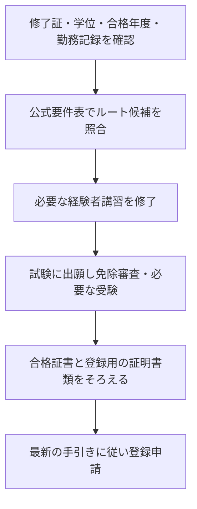

<!-- TARGET_KW: 登録日本語教員 経過措置 いつまで / READER: S3-義務-検討前 / 検索 / ANSWER: Cは2033年3月31日、D〜Fは2029年3月31日までだが経歴で必要手続きが異なる / TAKEAWAY: ルート別の免除・講習・出願・登録の区別 -->

日本語教師として働いている、または養成課程を修了していて、「登録日本語教員の経過措置はいつまで使えるのか」と調べている人向けの記事です。

期限は一つではありません。養成課程の種類、学位、現職経験、旧検定の合格時期によって、確認するルートと残る手続きが変わります。

この記事では、2026年11月1日に確認した文部科学省の資料から、期限と必要な行動を対応させます。筆者は日本語教員試験を未受験で、登録申請の体験ではありません。

## 経過措置はCとD〜Fで期限が違う

文部科学省の要件表では、Cルートは2033年3月31日まで、現職経験を要するD-1・D-2・E-1・E-2・Fルートは2029年3月31日までの経過措置期間が示されています。[文部科学省・資格取得ルートに関する要件](https://www.mext.go.jp/content/20260515-mxt_nihongo02-000046619_1.pdf)

| ルート | 経過措置期間の終期 | 最初に確認する経歴 |
|---|---|---|
| C | 2033年3月31日 | 文科省確認済みの50項目対応課程の修了と学士以上の学位 |
| D-1・D-2 | 2029年3月31日 | 現職経験、対象の養成課程、学士以上の学位 |
| E-1・E-2 | 2029年3月31日 | 現職経験と、対象期間内の旧日本語教育能力検定試験合格 |
| F | 2029年3月31日 | 現職経験。上記の課程・旧検定による免除を使わない場合 |

出典: [文部科学省・資格取得ルート要件表](https://www.mext.go.jp/content/20260515-mxt_nihongo02-000046619_1.pdf)（2026年11月1日確認）

この終期を「その日に試験に申し込めば間に合う」という意味で使わないでください。講習・出願・合格証書の取得・登録申請には別々の手続きがあります。

利用する年度の試験要項と登録の手引きで、完了させる内容と期限を確認する必要があります。

## C〜Fルートで必要な試験と講習を比べる

経過措置は「資格を自動で付け替える制度」ではありません。自分の経歴が条件を満たす場合に、試験や研修の一部が免除される仕組みです。

| ルート | 経験者講習 | 基礎試験 | 応用試験 | 実践研修 |
|---|---|---|---|---|
| C | 不要 | 免除 | 要受験 | 免除 |
| D-1 | 講習Ⅱ | 免除 | 要受験 | 免除 |
| D-2 | 講習Ⅰ・Ⅱ | 免除 | 要受験 | 免除 |
| E-1 | 講習Ⅰ・Ⅱ | 出願して免除の判断を受ける | 出願して免除の判断を受ける | 免除 |
| E-2 | 講習Ⅱ | 出願して免除の判断を受ける | 出願して免除の判断を受ける | 免除 |
| F | 不要 | 要受験 | 要受験 | 免除 |

出典: [文部科学省・資格取得ルート要件表（講習と免除）](https://www.mext.go.jp/content/20260515-mxt_nihongo02-000046619_1.pdf)

D・Eルートでは、出願時に経験者講習の修了証を提出する必要があります。Eルートは両試験の受験が免除されても、試験への出願と免除の判断、合格証書の取得が必要です。[文部科学省・要件表の注9・注11](https://www.mext.go.jp/content/20260515-mxt_nihongo02-000046619_1.pdf)

たとえば「旧検定に合格済みだから、次は登録だけ」と進めると、現職経験・合格時期・講習・出願の確認が抜けます。試験を受けないことと、試験の手続きが不要なことは別です。

## 自分のルートは修了課程・学位・現職経験で確認する

### C・Dルートは課程名だけで決めない

Cルートの養成課程は、必須の教育内容50項目に対応する課程として文部科学省の確認を受けたものです。D-1は平成12年報告に対応する確認済み課程、D-2は該当する課程について文部科学省への確認が必要です。[文部科学省・要件表の注2〜4](https://www.mext.go.jp/content/20260515-mxt_nihongo02-000046619_1.pdf)

「420時間講座を修了した」という呼び方だけでは、CかDかは決まりません。同じ学校でも課程名や実施期間が違うことがあるため、修了証と公式の確認結果を照合します。

C・D-1・D-2は学士以上の学位が必要です。要件表では短期大学士・準学士・専門士・高度専門士は対象外とされています。

課程修了と学位の条件は別々に確認してください。[文部科学省・要件表の注6](https://www.mext.go.jp/content/20260515-mxt_nihongo02-000046619_1.pdf)

### D〜Fルートは現職経験を確認する

現職経験は、2019年4月1日から2029年3月31日までの間に、対象となる機関・課程で1年以上日本語教育を担当したことが条件です。対象には、告示を受けた課程、国内の大学・短期大学、認定を受けた課程、文部科学大臣が指定した機関等があります。[文部科学省・要件表の注1](https://www.mext.go.jp/content/20260515-mxt_nihongo02-000046619_1.pdf)

登録の手引きでは、1年以上の雇用期間と平均週1回以上の授業担当、複数機関の経験の合算や主任教員の場合の扱いも示されています。「現在教えている」という一言ではなく、勤務先・期間・担当内容を証明できるかを確認します。[文部科学省・登録申請の手引き「D-1ルート」](https://www.mext.go.jp/content/20261015-mxt_nihongo01-000034832_24.pdf)

### Eルートは旧検定の合格時期を確認する

E-1は1987年4月1日から2003年3月31日まで、E-2は2003年4月1日から2024年3月31日までにJEESが実施した日本語教育能力検定試験の合格が条件です。旧検定の名称だけでなく、実施年度を合格証で照合します。[文部科学省・要件表の注7・注8](https://www.mext.go.jp/content/20260515-mxt_nihongo02-000046619_1.pdf)

いずれにも当てはまらなければ、通常の試験ルートや養成機関ルートを確認します。「経過措置に当てはまらない」と「登録日本語教員になれない」は同じではありません。

## 期限から逆算して準備する順番

これは準備順の整理です。講習不要・受験免除などの違いは、上のルート表に従って読み替えてください。

| 状況 | 次にすること |
|---|---|
| どの課程を修了したか曖昧 | 修了証を確認し、学校に課程名・実施期間を問い合わせる |
| 現職経験の証明が必要 | 勤務先に証明書の発行方法と担当記録を確認する |
| Eルートと思うが未出願 | 合格年度と必要講習を確認し、試験の出願要項を読む |
| 試験に合格した | 登録申請の手引きで必要書類を照合する |

試験合格後の登録は別の手続きです。文部科学省の[日本語教育機関認定法ポータル](https://www.nihongokyouiku.mext.go.jp/)から、登録日本語教員の申請案内と最新資料を確認してください。

なお、登録日本語教員は認定日本語教育機関に関する資格制度です。日本語を教える仕事すべてに一律に取得が必要と読み替えず、勤務先が認定制度の対象か、求める要件は何かも確認します。[文部科学省・登録申請の手引き「制度の概要」](https://www.mext.go.jp/content/20261015-mxt_nihongo01-000034832_24.pdf)

## まとめ

登録日本語教員の経過措置は、Cルートが2033年3月31日、D〜Fルートが2029年3月31日までです。期限を知るだけでは足りず、自分の経歴と必要な講習・試験・登録を対応させる必要があります。

まず修了証、学位、旧検定の合格年度、勤務記録をそろえ、公式要件表に照合してください。旧資格からの自動移行ではなく、免除を受ける場合も手続きを進めることが重要です。
